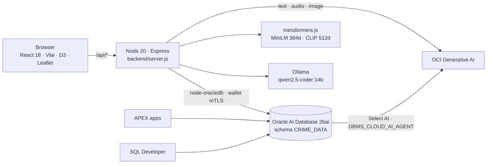

# IncidentData LiveStack — Technical Guide

[Functional Guide](FUNCTIONAL.md) · **Technical Guide** · [Project README](../README.md)

> This guide explains how the app is built. It follows the same sections as the [Functional Guide](FUNCTIONAL.md), which describes what people can do.

**Contents:** [Architecture](#architecture) · [Runtime and deployments](#runtime-and-deployments) · [Security and personas](#security-and-personas) · [Data model](#data-model) · [Feature map](#feature-map) · [AI services](#ai-services) · [Data Room pipeline](#data-room-pipeline) · [Guardrails](#how-the-ground-rules-are-enforced) · [Build and test](#build-and-test) · [Around the app](#around-the-app)

## Architecture



| Layer | Technology | Where |
|---|---|---|
| Frontend | React 18, Vite 5, D3 7 (graphs), Leaflet / react-leaflet (maps) | [`frontend/src`](../frontend/src) |
| API | Node 20, Express 4, helmet, morgan | [`backend/server.js`](../backend/server.js) and feature modules in [`backend/`](../backend) |
| Database access | `oracledb` 6 (Thin mode, wallet for ADB) | [`backend/database-connection.js`](../backend/database-connection.js) |
| Embeddings | `@huggingface/transformers`: `all-MiniLM-L6-v2` (text, 384d), `clip-vit-base-patch32` (image, 512d) | [`backend/embeddings.js`](../backend/embeddings.js) |
| Generative AI | OCI Generative AI SDK; Select AI and native agents inside the database | [`backend/data-room-structured-ai.js`](../backend/data-room-structured-ai.js) |
| ZIP handling | `yauzl` / `yazl`, `csv-parse` | [`backend/data-room.js`](../backend/data-room.js) |
| Media worker | Detective Room narration and video runtime | [`detective-worker/`](../detective-worker) |

## Runtime and deployments

The [`Containerfile`](../Containerfile) builds the frontend in a Node 20 stage, then copies `frontend/dist`, the backend, setup scripts and evidence assets into a production Node 20 image listening on port 3001.

| Deployment | Compose file | App URL | Database | Other services |
|---|---|---|---|---|
| FU40 (Autonomous DB) | [`compose.fu40.yml`](../compose.fu40.yml) | `http://localhost:8706` | ADB `fu40_medium` via wallet | OCI GenAI; Detective Room data volume |
| Local stack | [`compose.yml`](../compose.yml) | `http://localhost:8705` | Oracle Database Free container, port 1533 | ORDS 8381, Ollama 11445 |
| OCI Resource Manager (candidate) | [`deployment/oci-resource-manager`](../deployment/oci-resource-manager/README.md) | `https://<reserved-public-IP>` | New ADB | Terraform, Caddy TLS, APEX import |

Main configuration (set in compose, secrets supplied from an env file):

| Variable | Purpose |
|---|---|
| `ORACLE_USER`, `APP_SCHEMA_PASSWORD` | Application schema login (`CRIME_DATA`) |
| `ORACLE_CONNECTION_STRING`, `ORACLE_WALLET_LOCATION`, `ORACLE_WALLET_PASSWORD` | ADB service alias and wallet |
| `OCI_CONFIG_FILE`, `OCI_CONFIG_PROFILE`, `OCI_COMPARTMENT_ID`, `OCI_GENAI_REGION` | OCI SDK access for Generative AI |
| `OCI_GENAI_MODEL`, `CDR_TEXT_MODEL`, `CDR_AUDIO_MODEL`, `CDR_IMAGE_MODEL`, `CDR_LEARNING_MODEL` | Model choice per task |
| `OLLAMA_BASE_URL`, `OLLAMA_MODEL` | Local LLM |
| `CDR_ROOM_ENABLED`, `CDR_ROOM_ROOT` | Detective Room storage |

Functional view: [Functional Guide](FUNCTIONAL.md)

## Security and personas

- The app is a trusted middle tier. On each request it resolves the demo persona and sets it on the database session with `DBMS_SESSION.SET_IDENTIFIER`. Scoped views filter by that client identifier and by `SECURITY_USER_GEO_ENTITLEMENTS`.
- Deep Data Security (Oracle 23.26.2+) adds data roles and data grants. Three Autonomous DB kits show it with direct database logons: [Basic](../demos/DDS_Basic_CrimeData_ADB/README.md) (`ACI_B_*`), [Advanced](../demos/DDS_Advanced_CrimeData_ADB/README.md) (`ACI_A_*`, entitlement, clearance, patrol area and effective dates) and [Cross-Table Grant](../demos/DDS_CTG_CrimeData_ADB/README.md) (`ACI_C_*`).
- `adelaide_central_analyst` is accepted as an alias and resolved to `central_analyst` before any data access.
- In the public deployment, accounts are bound to personas on the server. A supplied `X-Demo-User` header cannot raise privileges.
- These are demonstration configurations. Production use needs real identity propagation through OCI IAM. See [Deep Data Security](deep-data-security.md).

Functional view: [Access depends on who you are](FUNCTIONAL.md#access-depends-on-who-you-are)

## Data model

Core tables in `CRIME_DATA` (from [`db/schema`](../db/schema) and [`db/migrations`](../db/migrations)):

| Area | Tables |
|---|---|
| Incidents | `CRIME_INCIDENTS`, `INCIDENT_REPORTS`, `INCIDENT_CATEGORIES`, `PATROL_AREAS` |
| Cases and evidence | `CASE_FILES`, `CASE_INCIDENT_LINKS`, `EVIDENCE_ITEMS`, `ANALYST_ACTIONS` |
| Persons of interest | `PERSONS_OF_INTEREST`, `PERSON_INCIDENT_LINKS`, `POI_IDENTIFIERS` |
| Vectors | `INCIDENT_REPORT_EMBEDDINGS`, `PERSON_NARRATIVE_EMBEDDINGS`, `PERSON_PROFILE_EMBEDDINGS`, `PERSON_VISUAL_EMBEDDINGS`, `SEMANTIC_MATCHES` |
| Patterns and signals | `WATCHED_CRIME_PATTERNS`, `WATCHED_PATTERN_INCIDENTS`, `WATCHED_PATTERN_POSTS`, `SOCIAL_MEDIA_SOURCES`, `SOCIAL_MEDIA_POSTS`, `SOCIAL_POST_INCIDENT_LINKS` |
| Security | `SECURITY_USERS`, `SECURITY_USER_GEO_ENTITLEMENTS` |
| Profiles | `DEMO_DATA_PROFILES`, `Z_BASE_DATASET_PROFILES`, `Z_BASE_ACTIVE_DATASET_PROFILE` |
| Data Room | `CDR_*` tables, including `CDR_WORKSPACE_RUNS`, `CDR_BATCH_VECTORS`, `CDR_AGENT_TOOL_EVENTS`, `CDR_CHAT_THREADS`, `CDR_DATA_PRODUCTS` |

Property graphs:

| Graph | Used by |
|---|---|
| `CRIME_CASE_NETWORK` | Case Relationships |
| `CDR_CONNECTIONS_GRAPH_V1` | Data Room connection review |
| `CDR_MONEY_GRAPH_V1` | Money Flows |
| `CDR_MSG_GRAPH_V1` | Messages |
| `CDR_PHOTO_GRAPH_V1` | People & Photos (photo → region → POI) |

City profiles are captured as Z_BASE snapshots and restored through Data Foundation ([`backend/profile-restore.js`](../backend/profile-restore.js), [`backend/profile-library.js`](../backend/profile-library.js)). The Adelaide v5 load is [`db/demo/15_load_adelaide_synthetic_21513_v5.sql`](../db/demo/15_load_adelaide_synthetic_21513_v5.sql); its source CSVs are published in [`fucci/CrimeDataLiveStack-data`](https://github.com/fucci/CrimeDataLiveStack-data).

## Feature map

Each menu item, with its main frontend view, API routes and backend modules.

| Menu | Frontend | API | Backend modules |
|---|---|---|---|
| ▦ Data Foundation | [`main.jsx`](../frontend/src/main.jsx), [`SavedProfileReview.jsx`](../frontend/src/SavedProfileReview.jsx) | `/api/setup` | [`profile-restore.js`](../backend/profile-restore.js), [`setup-profile-selection.js`](../backend/setup-profile-selection.js) |
| ▤ Incident Activity Center | [`main.jsx`](../frontend/src/main.jsx) | `/api/dashboard` | [`server.js`](../backend/server.js) |
| ⌁ Incident Pattern Signals | [`main.jsx`](../frontend/src/main.jsx) | `/api/watched-patterns`, `/api/patterns`, `/api/community-signals` | [`pattern-embeddings.js`](../backend/pattern-embeddings.js), [`community-signals-summary.js`](../backend/community-signals-summary.js) |
| ◎ Incident Map | [`ClusteredProfileMap.jsx`](../frontend/src/ClusteredProfileMap.jsx) | `/api/incidents` | [`live-incident-map.js`](../backend/live-incident-map.js) |
| ▤ Incident Explorer | [`main.jsx`](../frontend/src/main.jsx), [`ResultRelationships.jsx`](../frontend/src/ResultRelationships.jsx) | `/api/incidents` | [`incident-semantic-search.js`](../backend/incident-semantic-search.js), [`result-relationships.js`](../backend/result-relationships.js) |
| ◌ Incident and Capacity Analytics | [`main.jsx`](../frontend/src/main.jsx) | `/api/analytics` | [`server.js`](../backend/server.js) |
| ◉ Person Intelligence | [`PoiIdentifierDialog.jsx`](../frontend/src/PoiIdentifierDialog.jsx), [`PoiVisualSearch.jsx`](../frontend/src/PoiVisualSearch.jsx) | `/api/persons` | [`poi-identifiers.js`](../backend/poi-identifiers.js), [`poi-identifier-detail.js`](../backend/poi-identifier-detail.js), [`poi-catalogue.js`](../backend/poi-catalogue.js) |
| ▧ Evidence Intelligence | [`EvidenceIntelligence.jsx`](../frontend/src/EvidenceIntelligence.jsx) | `/api/evidence-intelligence` | [`evidence-intelligence.js`](../backend/evidence-intelligence.js) |
| ⌘ Case Relationships | [`OracleCaseGraph.jsx`](../frontend/src/OracleCaseGraph.jsx) | `/api/graph` | [`server.js`](../backend/server.js), graph `CRIME_CASE_NETWORK` |
| ✦ Ask IncidentData | [`main.jsx`](../frontend/src/main.jsx) | `/api/ask` | [`ask-crime-v2-results.js`](../backend/ask-crime-v2-results.js), Select AI profile `CRIMEDATA_SELECT_AI_V2` |
| ◉ AI Agent Console | [`NativeAgentV2.jsx`](../frontend/src/NativeAgentV2.jsx), [`AgentHistory.jsx`](../frontend/src/AgentHistory.jsx) | `/api/agents`, `/api/agent-v2` | [`agent-console-routes.js`](../backend/agent-console-routes.js), [`agent-history.js`](../backend/agent-history.js), team `CRIMEDATA_PATTERN_INVESTIGATION_TEAM` |
| ◴ AI Opps | [`AiOps.jsx`](../frontend/src/AiOps.jsx) | `/api/ai-ops` | [`ai-ops-telemetry.js`](../backend/ai-ops-telemetry.js), [`ai-ops-store.js`](../backend/ai-ops-store.js), [`ai-ops-registry.js`](../backend/ai-ops-registry.js) |
| ▣ Data Room | [`DataRoom2.jsx`](../frontend/src/DataRoom2.jsx), [`BatchExplore.jsx`](../frontend/src/BatchExplore.jsx) | `/api/data-room` | See [Data Room pipeline](#data-room-pipeline) |

Functional view: [The journey](FUNCTIONAL.md#the-journey)

## AI services

| Service | Configured as | Used for |
|---|---|---|
| Select AI (NL2SQL) | Profile `CRIMEDATA_SELECT_AI_V2` | Ask IncidentData |
| Select AI chat | Profile `CDR_WORKSPACE_AI_V1`, `DBMS_CLOUD_AI.GENERATE(action=>'chat')` | Data Room chat |
| Native agent teams | `DBMS_CLOUD_AI_AGENT.RUN_TEAM`: `CRIMEDATA_PATTERN_INVESTIGATION_TEAM`, `CDR_CONNECTION_REVIEW_V2`, `CDR_MONEY_REVIEW_V2` | Agent Console, connection review, money routes |
| Agent tools | `CDR_INVENTORY_V1`, `CDR_BRIEF_V1`, `CDR_CONNECTIONS_V1`, `CDR_MONEY_ROUTES_V1`, `CDR_MONEY_EVIDENCE_V1`, `CDR_MONEY_SUMMARY_V1`, `CDR_MONEY_LOG_V1`, `CDR_LOG_TOOL_V1` | Read-only access to saved context through scoped views |
| OCI Generative AI | Default `google.gemini-2.5-flash` for text, audio and image; `xai.grok-4.6` for learning; `meta.llama-3.3-70b-instruct` general; region `us-chicago-1` | File descriptions, Batch Brief, People mentioned |
| Local embeddings | MiniLM (384d text), CLIP (512d image), stored as `VECTOR` | Similarity, connections, photo regions |
| Ollama | `qwen2.5-coder:14b` | Local stack only |

Structured AI calls go through [`data-room-structured-ai.js`](../backend/data-room-structured-ai.js): a JSON schema for the reply, a validator, per-model output-token caps and a deadline (95 s for workers, 180 s for interactive People mentioned). Every attempt is recorded in AI Ops with tokens, retries and a trace reference.

## Data Room pipeline

| Stage | What runs | Stored in ADB |
|---|---|---|
| 1. Load | Upload, allocate Batch ID | Original archive |
| 2. Unzip | `yauzl` extraction, file-type counts | File inventory |
| 3. Ingest | Checksums and sizes per source | Source rows |
| 4. Identify & describe | OCI GenAI description per file (text, audio transcript, image) | Versioned descriptions ([`data-room-descriptions.js`](../backend/data-room-descriptions.js)) |
| 5. Learn | Batch Brief with source citations ([`data-room-learning.js`](../backend/data-room-learning.js)) | Brief versions |
| 6. Connect | Node extracts text references and builds vectors; ADB `VECTOR_DISTANCE` compares them; `RUN_TEAM` reviews the graph with three tools ([`data-room-connections.js`](../backend/data-room-connections.js)) | `CDR_BATCH_VECTORS`, `CDR_AGENT_TOOL_EVENTS`, connection graph JSON |
| 7. Publish | Deterministic, immutable review pack | `CDR_DATA_PRODUCTS`: `review.json`, `manifest.csv`, `connections.csv`, `timeline.csv` |

Workspaces: [`data-room-money.js`](../backend/data-room-money.js) and [`data-room-money-agent.js`](../backend/data-room-money-agent.js), [`data-room-messages.js`](../backend/data-room-messages.js), [`data-room-people-photos.js`](../backend/data-room-people-photos.js), [`data-room-people-mentioned.js`](../backend/data-room-people-mentioned.js), [`data-room-travel.js`](../backend/data-room-travel.js), [`data-room-workspace.js`](../backend/data-room-workspace.js) (chat).

Operating limits: a ten-minute worker lease, a 180-second Oracle round-trip timeout, one active connection run and one active chat turn per batch, 100 turns per thread, and 1,500 nodes / 3,000 edges per graph. People mentioned accepts 24,000 characters per source, 80,000 combined and returns at most 60 mentions.

Details: [Workspace guide](crime-data-room-workspace.md) · [Stage 6 graph](data-room-stage6-oracle-graph.md) · [Unified batch graph design](unified-batch-evidence-graph-plan.md)

Functional view: [Data Room](FUNCTIONAL.md#data-room-from-a-zip-of-material-to-a-reviewed-case-picture)

## How the ground rules are enforced

| Rule | Mechanism |
|---|---|
| Every claim has a source | Validators reject AI replies whose quotes are not exact substrings of the source; source IDs are checked against the batch manifest; unknown references fail the turn |
| AI output is a draft | Matches and groupings are stored as candidates or session results. No POI records or identity links are created by AI |
| No scoring or prediction | Agents are given read-only tools only; no SQL-generation or external-action tools are registered |
| Everything is audited | `CDR_AGENT_TOOL_EVENTS`, agent conversation history in JSON, review decisions and AI Ops telemetry |

Functional view: [Ground rules](FUNCTIONAL.md#ground-rules) · [Agent roadmap](../AGENTIC_FRAMEWORK_ROADMAP.md)

## Build and test

```bash
npm install && npm run build      # backend deps + frontend production build
npm test                          # node --test test/*.test.js
podman compose up --build -d      # local stack on 8705
podman compose -f compose.fu40.yml up --build -d   # FU40 on 8706
```

Browser and live checks are in [`scripts/`](../scripts) (for example `test_people_grouped_browser.cjs`, `check_profile_restore_live.js`). Release validation for the Resource Manager deployment is described in its [runbook](../deployment/oci-resource-manager/RUNBOOK.md).

## Around the app

- **APEX**: DickTracy apps run against `CRIME_DATA`; the deployment package imports three APEX apps.
- **SQL Developer**: `CrimeData_ADB` connection (ADB wallet) and `CrimeData` (local container, `FREEPDB1`).
- **Repositories**: app in [`fucci/CrimeDataLiveStack`](https://github.com/fucci/CrimeDataLiveStack), data in [`fucci/CrimeDataLiveStack-data`](https://github.com/fucci/CrimeDataLiveStack-data).

---

[Functional Guide](FUNCTIONAL.md) · **Technical Guide** · [Project README](../README.md)
