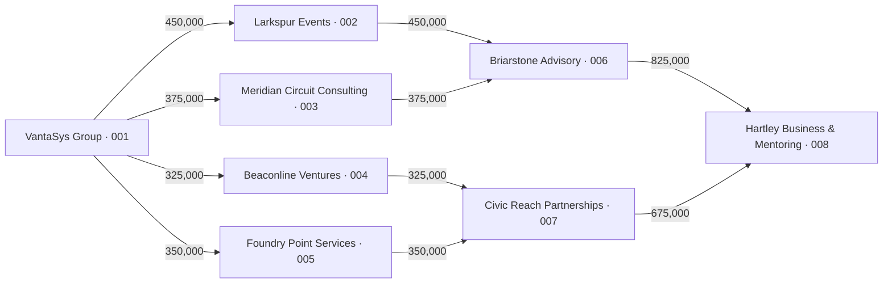
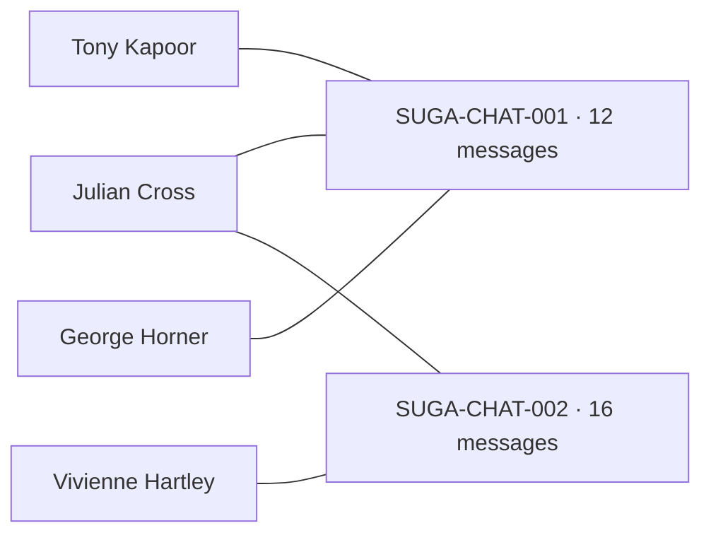

# Data Room: money, photo and conversation graphs

Investigation: 14 September 2026. Scope: the user's three proposed extensions to the fictional IncidentData demonstration. This is a design and source-data investigation, not an implementation or deployment. It extends the [unified graph design](unified-batch-evidence-graph-plan.md) with the current Suga batch and message-conversation requirements.

## Recommendation

Build one versioned batch evidence model in Oracle, with three focused views: **Money flows**, **People & photos**, and **Messages & conversations**. Give each view a source inspector and a shared full-name POI selector. Add a combined investigation view after the three individual views are working.

Use Suga as the first end-to-end demonstration. It contains all three source types and a useful difference between what a transaction records, what someone says, and what a photo comparison suggests. Build financial parsing and message reconstruction first, then persist the existing manual photo-region searches. Evaluate automatic region detection as a further increment.

Oracle native graph queries and the frontend renderer are separate choices. The current application already has D3 and SVG components; the Oracle Graph Visualization Library remains an optional renderer dependency requiring its distribution. It need not block source parsing, schema design, or native graph-query work.

## What was actually checked

Read-only inspection of the active FU40 application on port 8706, original batch files through the authorised source-download API, the POI catalogue, current source code, and Oracle metadata. Financial counts below were computed in memory using integer cents. Message counts were obtained from source structures and speaker headers. No additional AI inference, source edits, database writes, graph creation, retry, or deployment was performed during this investigation.

| Current source | Observed contents | Why it is useful |
| --- | --- | --- |
| `Suga_Scene4.zip`, batch `DR-20260914-13f650e8-dfa8-450e` | 7 files: 10 bank transactions, 2 conversations, 3 photos, 1 narrative | Complete first demonstration; stages 1–6 complete, stage 7 pending at inspection |
| `AliceSprings_Scenario_1A.zip`, batch `DR-20260914-2df10d57-2a01-4a00` | 14 files: 9 transactions, 4 conversation exports, 7 photos, travel CSV and narrative | Additional schema, date and alias cases; stage 4 currently failed, later stages pending |
| POI catalogue | 15 visible profiles; 13 report narrative and visual vectors ready | The four new V2 profiles are present; Alder and Meridian remain unavailable |
| Oracle | 26ai Enterprise Edition `23.26.3.3.0`; `CREATE PROPERTY GRAPH` privilege present | Native graph foundation available |
| Existing `CRIME_CASE_NETWORK` | Valid property graph; a read-only `GRAPH_TABLE` vertex count returned 28,229 | Confirms native graph querying works on this instance; does not establish new batch-graph access controls |

The existing Stage 6 graph links files through literal references, description similarity, whole-scene similarity and checksum-based declared cast. It does not yet contain individual bank transfers or messages. The optional POI panel performs manual crop searches but does not save those candidates into the graph. The Batch Assistant's stored chat is also separate from conversations supplied inside a ZIP.

## 1. Money flows

### What Suga can already demonstrate

`transactions.csv` contains 10 distinct transfers between 8 account identifiers. All rows explicitly declare AUD. Dates are 11, 12 and 14 September 2026, with no time of day. Source `STAGE` values are 1, 2 and 3; these describe the supplied scenario and must not be treated as a detected laundering classification.

This diagram follows the exact account-to-account rows. The labels are the party names recorded against those accounts; the amounts are AUD.

Account suffixes above refer to the source's `SYN-AUD-001` through `SYN-AUD-008` identifiers. Original CSV records 1–10 are transactions `SUGA-TX-001` through `SUGA-TX-010`.

Useful measures for the first UI:

| Measure | Result in this source | Meaning |
| --- | --- | --- |
| Recorded transfers / distinct directed account pairs | 10 / 10 | Individual transaction count and aggregated-edge count happen to agree here |
| Start-account outflow | AUD 1,500,000 | Sum of four recorded VantaSys transfers |
| End-account inflow | AUD 1,500,000 | Sum of two recorded Hartley Business & Mentoring receipts |
| Gross transfer volume | AUD 4,500,000 | Sum across all ten edges; includes movement across three stages |
| Complete source-to-destination routes | 4, each 3 hops | Four distinct paths from account 001 to account 008 |
| Split / convergence nodes | 1 / 3 | One account sends to multiple accounts; Briarstone, Civic Reach and Hartley receive from multiple accounts |
| Intermediate accounts with equal recorded inflow and outflow | 6 | Balance of the observed transfers, not an account balance or proof of the same funds |
| Directed cycles | 0 | A circular-flow demonstration needs a separate synthetic test case |

The graph can show splitting, convergence and onward transfers over three calendar days. Neither the graph shape nor this small fictional dataset supports a calibrated percentage likelihood of money laundering. Start with named patterns and measurable criteria: number of branches, routes, hops, elapsed dates and amount comparisons. If a later scoring model is wanted, define and evaluate it separately, including ordinary business patterns that look similar.

### User experience

Use a left-to-right directed network, with date and currency filters, account/party search, selectable hop depth, and an expandable transfer table. Selecting an edge opens its individual rows, source file, transaction IDs, exact amount, date and description. Parallel transfers must remain separately inspectable even when one displayed arrow aggregates them. Highlight a selected route and show its constituent transactions.

Offer **Split payments**, **Converging payments**, **Onward transfers**, **Repeated pairs**, and **Circular routes** as review-pattern filters. Display the exact rule and time window beside a hit. Date-only data supports ordering across days; it cannot justify a claim such as “forwarded within minutes.”

A Sankey can be useful for this balanced Suga example, but the default account network should also handle unbalanced and cyclic data. Label gross movement explicitly so repeated onward movement is not presented as additional originating money.

### Parsing and native queries

Support three known source schemas initially:

- Suga: `TRANSACTION_ID,TDATE,SENDER,SENDER_ACCOUNT,RECEIVER,RECEIVER_ACCOUNT,AMOUNT,CURRENCY,DESCRIPTION,STAGE,SYNTHETIC`.
- Alice Springs: `TDATE,SENDER,SENDER_ACCOUNT,RECEIVER,RECEIVER_ACCOUNT,AMOUNT,DESCRIPTION,FLAG`; dates use `DD-MON-YYYY`, currency is absent and there is no transaction ID.
- Downloadable sample: `transaction_id,date,from_account,to_account,amount_aud,reference`.

Use decimal-safe values stored as Oracle `NUMBER`, explicit date-format adapters, source record ordinals and stable IDs based on batch/item/record. Keep account identifiers as strings. Report malformed rows and unparsed coverage. Preserve duplicate source rows with their own provenance until a reviewer resolves them. Unknown currency stays unknown; the Alice file's own `FLAG` remains a source field.

Alice has 9 directed transfers across 8 accounts and three three-hop routes. Some intermediary outflows exceed their observed inflows, so tracing a unique pot of money through it would require information the file does not supply.

Native graph vertices represent accounts; each transfer is a directed edge with transaction and source references. Oracle documents directed, bounded-hop and cyclic `GRAPH_TABLE` queries. Use those for the path topology, and relational SQL for exact sums and row reconciliation. Start with a low, explicit maximum hop count and result cap to bound path expansion. [Oracle SQL graph query examples](https://docs.oracle.com/en/database/oracle/property-graph/26.3/spgdg/examples-sql-property-graph-queries.html)

## 2. People and batch photos

### Existing capability and next step

The application can already select a manual photo region, generate its 512D CLIP vector, and compare it with compatible authorised reference portraits using Oracle cosine distance. It returns up to three distinct candidate profiles, plus source/crop checksums and bounding-box coordinates. The missing step is durable region/candidate storage and graph integration.

Proposed interaction:

1. Open a photo and draw a region around one fictional character, or accept a proposed region once detection is available.
2. Compare the region against the registered portrait vectors; show the crop, candidate headshots, full names and raw cosine scores together.
3. Save the candidate comparison and mark its review state as pending, accepted for the demo, rejected or uncertain.
4. Open a graph with photo thumbnails and POI portraits. Candidate edges are dashed and labelled; accepted review assertions carry reviewer and timestamp information.
5. Select a POI to see all saved matching regions in the selected batch, with the original photos and boxes available on click.

The underlying chain is **Photo → Region → Candidate POI**, with a separate review assertion. A simplified displayed Photo → POI edge should retain that full chain in its inspector. Two candidates in the same photo may justify a shared-photo view, but do not create a separate business, communications or money-transfer relationship automatically.

### Automatic batch search

“Search every photo” requires region discovery as well as vector search. A whole-scene vector can be dominated by setting and clothing when several characters appear together. Persist region vectors first; then compare all saved regions in a batch with the reference catalogue. Add an automatic detector only after benchmarking it on the fictional scenes. Grounding DINO is one candidate to evaluate for proposing object/person boxes; its documented outputs contain boxes, labels and detection scores. Runtime suitability on this server remains untested. [Grounding DINO documentation](https://huggingface.co/docs/transformers/model_doc/grounding-dino)

Keep detector scores and cosine scores separate. Test correct candidates, similar-looking distractors, unknown characters, occlusion and small crops. CLIP's model card calls for testing in the intended domain; the previous small portrait tests do not establish mixed-scene accuracy. [CLIP model card](https://huggingface.co/openai/clip-vit-base-patch32)

Suga has three suitable scene files. No new crop searches or appearance findings were made in this investigation. The recent Julian portrait replacement makes a useful regression test against George Kaplan: compare existing scene crops against Julian's current reference and retain both the source-photo and portrait hashes. Older comparisons must retain their earlier reference version. Scores should not silently change when a portrait is replaced.

The current catalogue reports 13/15 vector-ready profiles. Show that coverage before a batch scan and keep the two unavailable placeholders explicit. Benchmark results should use author-provided cast labels for evaluation, independently of retrieval; filenames or cast labels must not boost the search ranking.

## 3. Message graphs and conversation reading

### Actual formats and counts

| Source | Observed structure | Display implications |
| --- | --- | --- |
| Suga `first_convo.json` | `thread_id`, `participants`, 12 `messages`, each with `timestamp`, `sender`, `text` | One 3-person thread; Julian sends 6 messages, George 3, Tony 3. Offset `+10:00` is explicit. Individual recipients/reply IDs are absent. |
| Suga `2nd_Convo.txt` | Thread/date/time-zone header, 16 timed speaker blocks | One Julian/Vivienne thread; 8 messages each; 10 September 2026, 20:14–20:44 AEST. Parse multiline bodies to the next speaker header. |
| Alice `Red_Dirt_*.txt` | 96 detected speaker blocks across 27 dated sections in 4 files | Per-section dates/times, mostly handle-pair headings; most individual messages have no timestamp. Counts are an exploratory header scan, not a completed validated import. |
| Downloadable sample `records/messages.csv` | `message_id,sent_at,sender_ref,recipient_ref,message` | Explicit directed sender/recipient messages; no declared thread ID. |

Use a participant-to-thread graph for group conversations. A message posted to a group is not necessarily a direct message to every other member. Suga's current source gives four named participants linked through two threads:

Selecting a thread opens a chronological conversation panel: full sender name, message body, timestamp or source-order position, original time zone, and a source link. Selecting a participant filters to their threads; selecting a message highlights its origin. Preserve the original spelling, punctuation, multiline text and surrounding exchange. Search terms can highlight matching messages without hiding the rest of the conversation.

Preserve JSON array position/JSON Pointer for JSON, parsed record number for CSV, and offsets plus line references for TXT. CSV record ordinals are not always physical line numbers because quoted messages can contain newlines. Store original order as the stable tie-breaker. Unspecified time zones and per-message times remain unspecified; a section timestamp is displayed as a section timestamp.

Represent `reply_to` only when supplied. Where a thread ID is absent, present a provisional grouping by source/section or participant set, label that grouping method, and support review of boundaries. Keep group participation and observed direct sender/recipient traffic as distinct edge types.

### Names, handles and context

Alice uses `pipp68`, `kappa66`, `thorny58` and `evek81`. These handles are not present in the live POI `alias_name` fields. Create source-handle nodes initially; mapping one to a full POI name needs an explicit scenario mapping or reviewer assertion. “Roger Thornhill” in the transaction CSV also must not collapse into Clara Thornhill because their surnames match.

Suga's second conversation contains Vivienne questioning the proposal and objecting to being represented as having agreed. A communications graph only records the exchange. Link inspections and any agent summary must retain those statements alongside Julian's claims, rather than implying agreement from participation or incoming payments.

Keep source-conversation tables and routes distinct from the existing `cdr_chat_threads` / Batch Assistant conversations. An analyst asking the AI a question must not become an event in the imported communications graph.

## Shared Oracle model and integration

Use typed relational records for validated transfers, messages, participants, threads and image regions. Keep variable source metadata and extraction/review details in JSON. Store compatible model vectors with their source/reference versions. Build a new native batch property graph over these records, alongside the existing case graph.

| Record group | Key information |
| --- | --- |
| Evidence runs and source mappings | Batch, parser/version, item hash, coverage, run status, exact source locator |
| Accounts, parties and associations | Stable source ID, source-provided name, scope, association basis |
| Transfers | Distinct transfer ID, account endpoints, exact amount/currency, date/time precision, source record |
| Source threads, handles, membership and messages | Raw identity label, grouping basis, sender/recipient, sequence, body, timestamp precision, source locator |
| Photo regions and vector candidates | Photo hash, oriented bounds, crop hash, model/preprocessing version, portrait hash, raw score |
| Reviews and derived patterns | Candidate/finding ID, rule parameters, source IDs, reviewer, status and revision |

Pin each graph result to a complete evidence-run version. Include batch and source/review/reference versions in fingerprints; the current description fingerprint alone will not detect a changed portrait, accepted candidate, parser or transaction import. Preserve previous runs and exports, and make retry/candidate-save requests idempotent.

Graph queries must enforce scope on every visited source, POI and intermediate node/edge. A graph filter applied only after traversal can expose hidden paths or aggregates. The successful existing-graph count was an administrative capability check, not a test of new graph visibility. Test hidden intermediate nodes, changed entitlements and cross-batch requests before releasing the new routes. Oracle documents support for property graphs over database views from release update 23.26.1; view-based scoping still needs verification on the proposed model. [Oracle graph version features](https://docs.oracle.com/en/database/oracle/property-graph/26.3/spgdg/key-property-graph-features-oracle-ai-database-26ai.html)

Extend Stage 6 with three independent result panels and status/coverage indicators. Deterministic transfer/message inspection should be possible once ingestion is ready; current-description and brief prerequisites should apply to the AI review, not block reading well-formed CSV/JSON. This matters for the current Alice batch, whose description stage is failed even though its originals are stored.

The Select AI Agent can use bounded tools to retrieve transfer-pattern results, conversation excerpts and saved photo candidates, then produce a cited cross-source explanation. SQL calculates sums and paths; parsers reconstruct messages; vector comparison supplies candidates. Persist the structured outputs before requesting the explanation so an agent failure does not discard the views. Introduce and test a new versioned team/profile where needed; keep the recently working Stage 6 team available.

Include a consistent source inspector and full names across all panels. A later combined view could connect a source-declared business association to a transfer account, a POI to a source conversation, and a saved region to a reviewed candidate. Each edge keeps its own basis. Spatial can be added when sources provide usable event/travel locations with precision metadata; a photo backdrop or company name does not supply a reliable coordinate.

## Renderer and release sequence

Oracle documents an embeddable JavaScript Graph Visualization Library with styling, exploration, tooltips and several layouts, distributed separately through Oracle Software Delivery Cloud. No matching package was found in the searched project/scratch file names. Use an authorised distribution if the finished demo is to use Oracle's renderer. An interim frontend prototype can reuse the application's existing D3/SVG renderer while querying a native Oracle graph. [Oracle visualization embedding guide](https://docs.oracle.com/en/database/oracle/property-graph/26.3/spgdg/embedding-graph-visualization-library-web-application.html)

Suggested implementation order:

1. **Money-flow slice:** recognise the three CSV schemas, persist versioned accounts/transfers, reconcile all source rows, query the native graph and show Suga's four routes with edge inspection.
2. **Conversation slice:** support Suga JSON/TXT and sample CSV first, add participant/thread graphs and a source-linked reader, then handle Alice's date-block exports and unresolved handles.
3. **Photo slice:** persist manual regions and all returned candidates, add review actions and the People & Photos graph, then enable reverse POI-to-saved-regions browsing.
4. **Combined review:** join the source-supported layers, extend versioned agent tools and new Stage 7 exports, and evaluate batch-wide automatic region detection.

For each slice, update batch removal and recovery rules for new dependent records, preserve old review packs, test visibility, and verify reopening after refresh/restart. Exports should include transfer records, message/thread records and candidate/review provenance with spreadsheet-safe CSV where applicable. Use bounded graph neighbourhoods and paginated tables/conversations rather than trying to draw every message at once.

Acceptance examples:

- Suga reconciles 10 transfers, 8 accounts, four 3-hop routes, AUD 1.5m initial/final totals and AUD 4.5m gross movement; no circular route is invented.
- Alice's 9 transfers retain unknown currency, date precision, original flags, distinct account identities and unequal observed intermediate totals.
- Suga reconstructs exactly 12 + 16 messages with unchanged wording, four distinct full-name participants and the original ordering/time zones.
- Group participation does not create fabricated individual deliveries; missing times and unresolved handles remain visible.
- Saved photo results survive refresh, preserve all comparison/review versions, and flag older portrait references. Julian/George distractors and absent-POI scenes are included in evaluation.
- Transfer/message counts and deterministic views remain inspectable if an optional agent explanation fails.
- The shared graph preserves source scope at intermediate nodes and every displayed relation opens its originating row, message or crop.

## Implementation touchpoints

- `backend/data-room-archive.js`: existing original-file validation and limits; leave the loader's archive contract intact.
- New parsing/persistence modules beside `backend/data-room-connections.js`: structured records, source locators and run versions.
- `backend/data-room-poi-candidates.js` and `backend/poi-catalogue.js`: reuse compatible vector queries; add separate durable save/review operations and source-version checks.
- `backend/data-room-workspace.js`: add separately versioned evidence snapshots/tool context and resilient review state.
- `frontend/src/BatchWorkspace.jsx` and `frontend/src/BatchPoiCandidates.jsx`: integrate the three views, persistent reviews and shared source navigation; put the conversation reader in a dedicated component.
- `backend/data-room.js`: account for new children and active work in batch removal/recovery.
- New additive setup script: typed tables, scoped views and batch property graph. Migration should be independently testable before any live deployment.

Next concrete build: Suga money flows plus its two conversation readers, sharing the versioned source model. No user input is needed to complete that design; renderer choice and automatic detector evaluation can be resolved during implementation.
