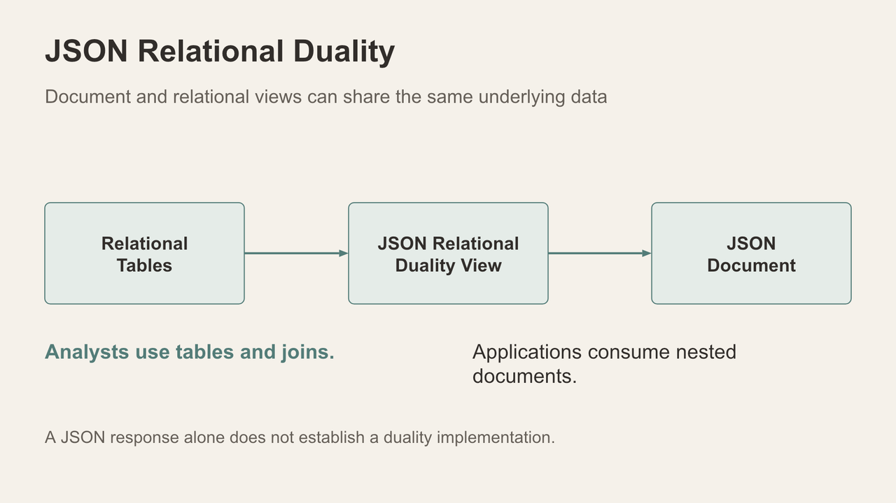
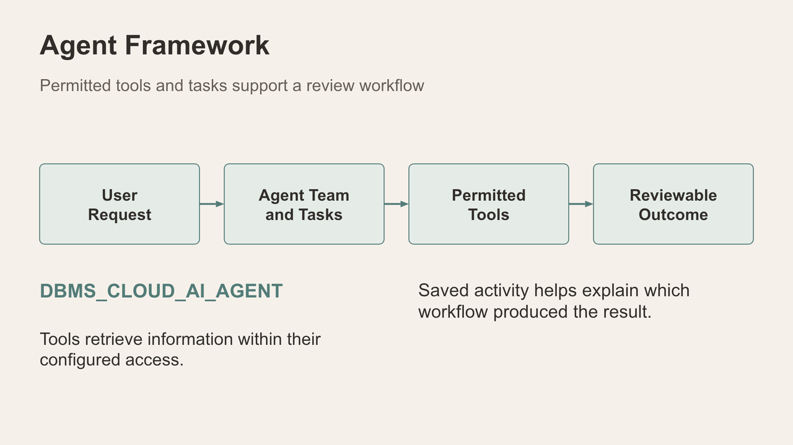

# Technology and application capability map

Use this reference when connecting an application result to Oracle AI Database 26ai and the configured Autonomous Database services.

*Complementary technologies support different ways to explore the incident context.*

| Capability | Question it helps explore | Workshop experience and execution distinction |
| --- | --- | --- |
| Relational SQL | What records satisfy these conditions? | Activity totals, record filters and guided queries use scoped SQL |
| Vector Search | Which descriptions have related meaning? | Narrative and profile exercises require compatible prepared embeddings; scores are similarity measures |
| JSON | How can varied content and nested attributes be represented? | Content, descriptions and saved workflow/audit payloads can have different shapes |
| JSON Relational Duality | How can documents and tables represent shared data? | Teach the database view definition; JSON output alone does not verify duality |
| Spatial | What geographic context surrounds a report? | Approximate map rendering and database record selection are distinct; inspect the query before claiming a native spatial operator |
| Graph | Which recorded relationships can be followed? | Some case views render relational projections; Data Room/evidence paths also contain native GRAPH_TABLE queries |
| Select AI | Can ordinary language lead to an inspectable database answer? | Guided templates and native Select AI are separate paths |
| AI Agent Framework | Which permitted tools support a multi-step request? | Native DBMS_CLOUD_AI_AGENT.RUN_TEAM paths coexist with guided workflows; review outcomes and supporting activity |
| Deep Data Security | Which products, rows and columns may this identity access? | App scoped views and separately installed native DDS grants need separate demonstrations |

Capability badges introduce a technology topic. They are not sufficient evidence that every screen uses the named native feature. In particular, In-Memory use requires database execution evidence beyond an activity-page badge.

*A true duality view maps relational data into a JSON document representation.*

*Agent teams use permitted tools to produce outcomes for review.*

## Sources for the technology concepts

- [Oracle AI Vector Search](https://www.oracle.com/database/ai-vector-search/)
- [Oracle Spatial concepts](https://docs.oracle.com/en/database/oracle/oracle-database/26/spatl/spatial-concepts.html)
- [Oracle SQL property graphs](https://docs.oracle.com/en/database/oracle/oracle-database/26/sqlrf/create-property-graph.html)
- [JSON Relational Duality views](https://docs.oracle.com/en/database/oracle/oracle-database/26/jsnvu/overview-json-relational-duality-views.html)
- [Select AI](https://docs.oracle.com/en/database/oracle/oracle-database/26/selai/select-ai-about.html)
- [Select AI Agent package](https://docs.oracle.com/en-us/iaas/autonomous-database-serverless/doc/dbms-cloud-ai-agent-package.html)
- [Deep Data Security data grants](https://docs.oracle.com/en/database/oracle/oracle-database/26/ddscg/data-grants.html)
