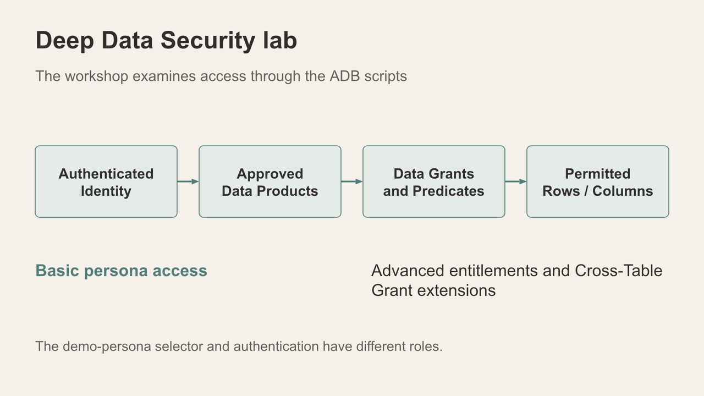

# Deep Data Security lab and script guide

Understand how a database identity, an approved product and an applicable grant shape the data returned by a query.

*The dedicated DDS lab examines identities, approved products and grants.*

## Separate the security mechanisms

The React app retains trusted-server client-identifier scoped views. Its demo-persona selector illustrates application scope. The ADB DDS kits teach native data products and grants through separately prepared direct-logon identities. A production application requires authenticated identity propagation.

Native data grants authorise rows and columns for Deep Sec end users or data roles. USE DATA GRANTS ONLY makes data grants the access path for Deep Sec users on the configured object; it does not remove ordinary object privileges held by standard database users. [Oracle data grant semantics](https://docs.oracle.com/en/database/oracle/oracle-database/26/ddscg/data-grants.html)

## Script sequence and execution identities

The following explains the source kits. Their database execution and negative checks remain to be validated on the release environment; they are not marked as a completed lab.

| Kit and file | Execution identity | Purpose and checkpoint |
| --- | --- | --- |
| Basic create/01_preflight.sql | ADMIN; owner follow-up if needed | Read database identity, required source objects, privileges and version; create nothing |
| Basic create/02_create_products_roles_grants.sql | Application schema owner | Create approved products, roles and grants; enable product grant-only mode |
| Basic create/03_create_end_users.sql | ADMIN | Create the direct-logon demo identities; passwords are prompted |
| Basic walkthrough/01_statewide_command.sql | Statewide command identity | Inspect approved statewide records, full reports and activity |
| Basic walkthrough/02_central_analyst.sql | Central analyst identity | Inspect Central safe rows and summaries; test a North filter and an ungranted command-report product |
| Basic walkthrough/03_strategy_viewer.sql | Strategy viewer identity | Inspect aggregate activity; test denial of incident-level access |
| Basic walkthrough/04_north_analyst.sql and 05_south_analyst.sql | Matching regional identity | Compare regional access using separate database sessions |
| Advanced create/01_preflight.sql | ADMIN | Verify prerequisites before installation |
| Advanced create/02_create_products_and_entitlements.sql | Application schema owner | Define products and seed the entitlement register |
| Advanced create/03_create_roles_and_grants.sql | Application schema owner | Define role/grant predicates using identity, area, clearance and dates |
| Advanced create/04_create_end_users.sql | ADMIN | Create the direct-logon extension identities |
| Advanced walkthrough/01_field_central.sql through 05_case_central.sql | Matching Field, Case or Command identity | Compare entitlement-driven product access |
| CTG create/01_preflight.sql | ADMIN | Verify cross-table grant prerequisites |
| CTG create/02_create_products_roles_and_grants.sql | Application schema owner | Define parent incident and child report products and their grants |
| CTG create/03_create_end_users.sql | ADMIN | Create the CTG demo identities |
| CTG walkthrough/01_central_investigator.sql through 03_statewide_reviewer.sql | Matching investigator/reviewer identity | Inspect parent-authorised incidents and related report access |
| CTG walkthrough/04_report_only_probe.sql | Report-only probe identity | Verify absence of child access without parent authorisation |

Basic is the proposed core route. Advanced entitlements and CTG are extensions, not prerequisites for completing the React exercises. Exact remote kit directories and current database identifiers are retained in the private instructor source map; the public application identity remains IncidentData.

## Read the Basic checks before executing

The Central script first reads safe incident columns, then explicitly requests North rows. Its intended result is an empty North selection. It then reads permitted report summaries and attempts to read the ungranted command report product. The Strategy script reads aggregate activity and attempts incident-level access, which is intended to be denied.

Record each query's identity, product, returned rows or error and interpretation. Empty rows and denied object access are different outcomes. Validate the actual denial behaviour and grants before lab delivery; do not substitute an assumed error number.

## Explain the Advanced and CTG extensions

Advanced grant predicates evaluate the controlled entitlement register using end-user identity, patrol area, clearance and effective dates. The kit uses ORA_END_USER_CONTEXT.username to reference the current end user. [Oracle end-user authorisation](https://docs.oracle.com/en/database/oracle/oracle-database/26/ddscg/fine-grained-data-authorization.html)

CTG derives child-report access from privileges on a related incident parent. Its probe identity has no parent grant, providing a negative check. Verify the installed release supports the kit's syntax: Oracle documents cross-table grants among the additions in release update 23.26.3. [Oracle release update and cross-table grants](https://blogs.oracle.com/database/oracle-deep-sec-extends-authorizations)

## Installation and cleanup boundaries

An instructor reviews preflight output and confirms the required administrative privileges before creating objects. Use an ADB wallet service alias; these kits do not use a local container switch. Keep passwords out of the guides and captured output.

Each kit has a separate drop/90_ cleanup script. The source guides describe removal of the Basic ACI_B_, Advanced ACI_A_ or CTG ACI_C_ objects respectively. Read the actual cleanup script and confirm its object scope before execution. Cleanup is an instructor operation after demo sessions disconnect; it is not a learner reset button.

Completion checkpoint: explain one allowed query, one excluded row set and one denied product using the actual identity and grant. The final lab needs recorded positive and negative results before release.
