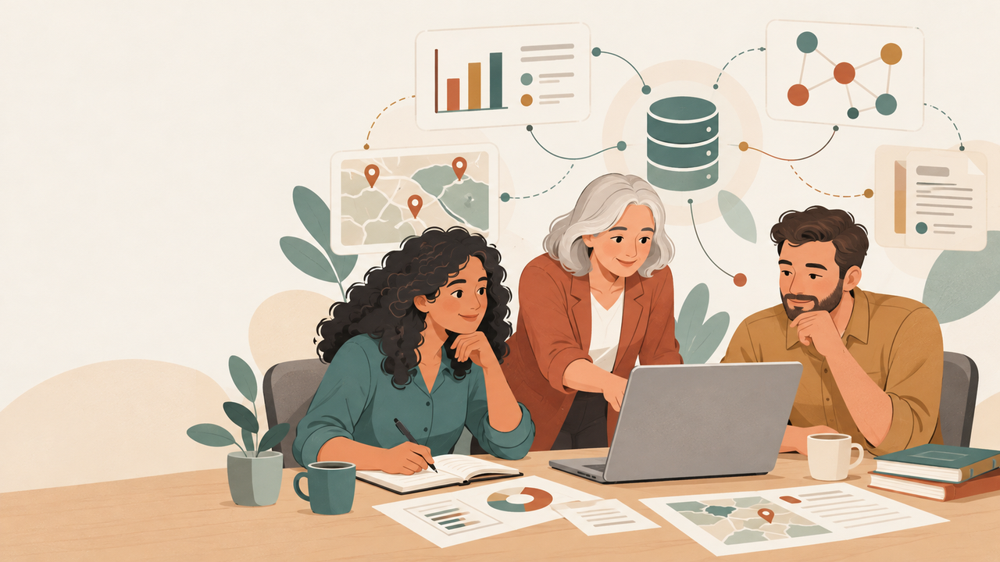
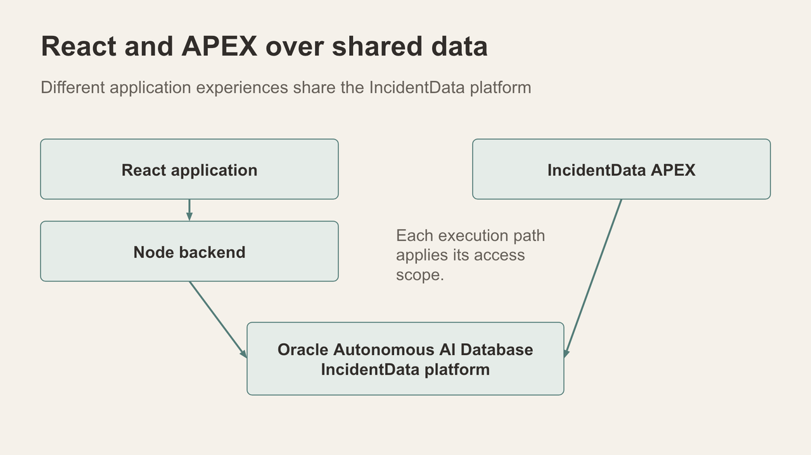

# IncidentData LiveStack workshop

Explore a fictional incident, inspect its sources, and understand the Oracle mechanisms behind the result.

This workshop is for developers, architects and technical learners. It connects practical application use with the data representations, queries and access rules that support it. The first documentation edition provides a guided Part 1 route and preparation guides for the later parts. This is a working workshop draft, dated 10 October 2026.

*Fictional analysts explore incidents through reports, maps and relationships.*

## What a LiveStack is

A LiveStack is a working application environment that brings together a user interface, application services, data and database capabilities around a practical scenario. You can explore the application, then follow a result back to the mechanisms that produced it.

IncidentData LiveStack introduces Vector Search, JSON, Spatial, Graph and JSON Relational Duality in the Oracle AI Database 26ai technology story, alongside Select AI and the AI Agent Framework in its Autonomous Database environment. Individual screens use their own implementation paths; the capability map explains those distinctions.

## Choose your route

| Chapter | Purpose | This edition |
| --- | --- | --- |
| [Part 1 React application](part-1-react.md) | Explore activity, reports, location, relationships and guided questions | Learner walkthrough; vector exercise requires prepared coverage |
| [Part 2 Data Room](part-2-data-room.md) | Follow supplied training content through a batch workflow | Saved-batch review and preparation guide |
| [Part 3 Oracle APEX](part-3-apex.md) | Compare another application experience over shared data | Chapter plan; live exercise validation pending |
| [Deep Data Security lab](dds-lab.md) | Explain products, identities, grants and verification scripts | Script guide; execution validation pending |
| [Technology and capability map](capability-map.md) | Connect screens to their execution mechanisms | Reference for the whole workshop |
| [Presenter and preparation guide](presenter-guide.md) | Prepare fixtures, explain limitations and reset the session | Instructor checklist |

A dedicated Graph Lab will follow in a future update. Current case relationships and database graph demonstrations remain part of the workshop.

## Before you begin

1. Obtain the application URL from your instructor. The current VS Code forwarding address is http://localhost:18706/; it works only while its SSH forwarding connection is available.
2. Confirm the application header shows IncidentData LiveStack and the intended city. The documented starting profile is Adelaide.
3. Choose Statewide administrator in Demo user for the opening exercise, unless your instructor has assigned another persona.
4. Use synthetic training data and fictional identities. The demo selector illustrates scopes; it is not a production sign-in mechanism.
5. Record the active city, persona and observed record dates. Dataset dates can differ from today's date, so short relative time windows can be empty.

You do not need database administration privileges for the core Part 1 screen walkthrough. AI exercises need configured services; DDS installation and APEX deployment belong to instructor preparation.

*Conceptual shared platform: React and APEX use the shared IncidentData environment.*

## What you should be able to explain

By the end of the core route, explain how an activity total connects to individual records, how a source supports a relationship, how a semantic candidate differs from a recorded link, and why two personas can receive different results. Also distinguish a reviewed SQL template from native AI execution.

The illustrations are static Redwood-inspired, Powtoon-like artwork. The diagrams are conceptual explainers; their captions and the capability map qualify what they show.
