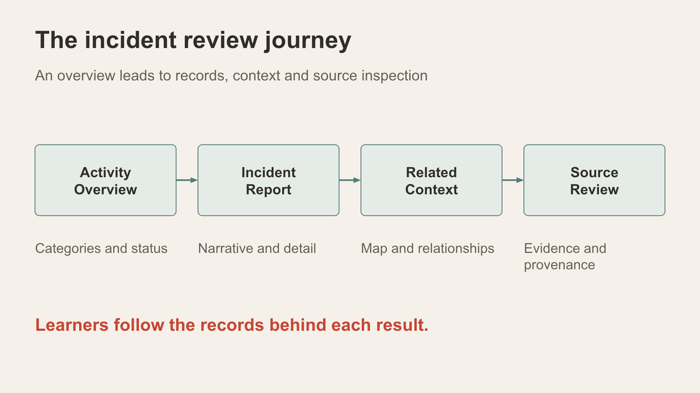
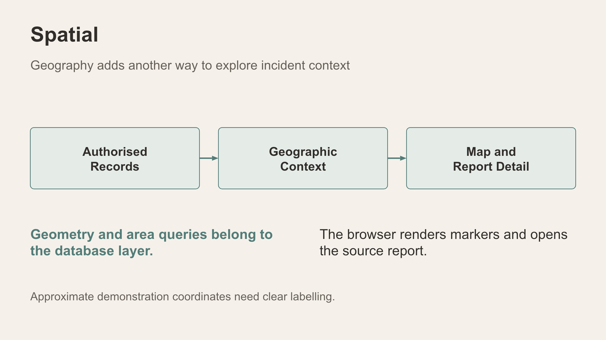
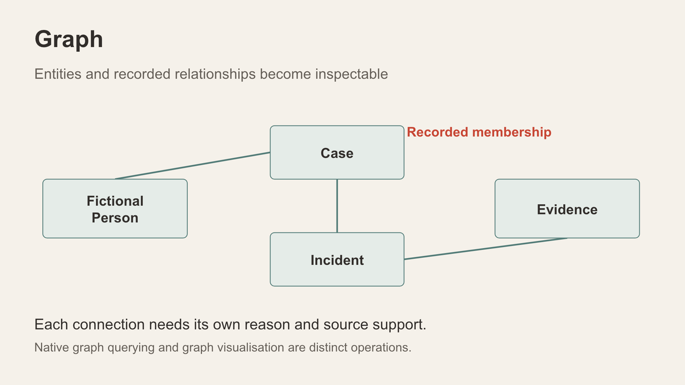
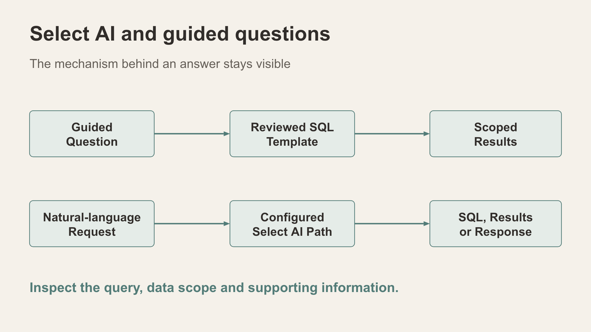
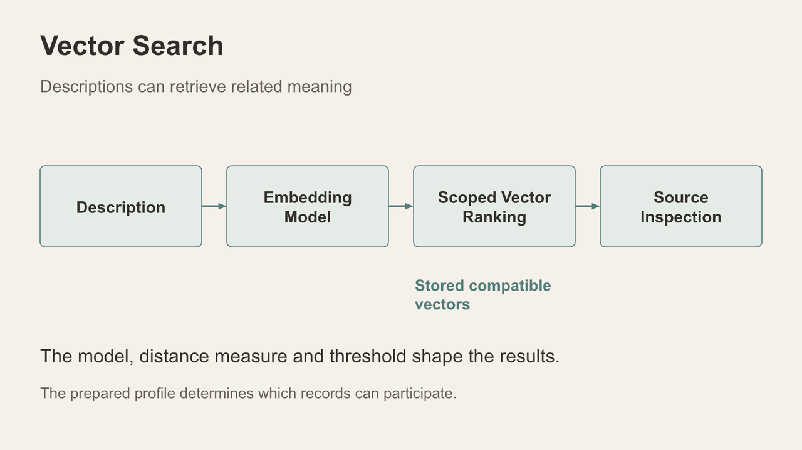

# Part 1 Explore incidents in the React application

Follow an incident from an activity overview to a source you can inspect. Use the current navigation labels and return to the starting persona at the end.

Prerequisites: a reachable application, an Adelaide training profile and access to the demo-persona selector. The core route is screen-based. Narrative vector search is an extension that requires compatible stored embeddings; native AI variants are optional.

*The learner journey connects an activity overview to source review.*

## Exercise 1 Establish the context

1. Open Welcome. Confirm IncidentData LiveStack and Adelaide in the header.
2. Open Data Foundation to inspect the available data context and profile information. Keep the prepared profile unchanged.
3. Record the persona and the dates visible in later incident records. Dataset restoration changes shared application data and belongs to instructor preparation.
4. Open the Oracle Internals explanation on a page to connect its interface to its stated mechanism. Close the explanation when finished.

Expected result: you can identify the city, persona and data context before interpreting a result. Reset: close the explanation; no dataset reset is required.

## Exercise 2 Compare activity scopes

1. Open Incident Activity Center with Statewide administrator selected.
2. Record Authorised incidents and the areas in Area coverage.
3. Change Demo user to Central analyst. Wait for the figures to refresh, and record the returned areas and total.
4. Change back to Statewide administrator and confirm the starting context returns.

Expected result: the regional view is restricted relative to statewide. Earlier observations on the prepared Adelaide profile were 21,532 statewide incidents and 8,030 Central incidents; these are examples, not fixed pass values for every profile.

Interpretation: a changed total demonstrates different application results. It alone does not establish native DDS enforcement. The dedicated security lab examines database identities and grants separately. Empty short-window charts can reflect the saved dataset dates.

Reset: restore Statewide administrator. Do not restore or reload the dataset.

## Exercise 3 Inspect one report

1. Open Incident Explorer and allow the records and filter lists to load.
2. Use the generic search field or the category, suburb, status and patrol-area filters to find a record of interest. Select a returned incident.
3. Read its reference, location precision, occurred-at date, report summary and narrative.
4. Compare the short summary with the narrative. Note the evidence and person-link counts, including when no related record is present.
5. Record the incident reference so you can recognise it in later views. Clear parameters when finished.

Expected result: a selected record opens a read-only form and its report content. The current profile includes masked synthetic addresses; an address labelled masked vicinity is not an exact event location.

Interpretation: preserve the distinction between a record's fields and conclusions you might draw from them. This exercise does not require Ask Me (LLM) or Ask Me (OCI GenAI).

Reset: clear search parameters and return to the starting persona.

*Original material, authored context and AI drafts remain distinguishable.*

## Exercise 4 Add location and relationship context

1. Open Incident Map. Inspect its available records and filters, and compare a displayed location with the report details where the interface offers them.
2. Open Case Relationships. Select an available case and inspect its connected incident, person and evidence context.
3. Open a source or detail view offered for a connection. State what the link represents and what source supports it.
4. Open Evidence Intelligence to inspect available source material and provenance. Read saved material first; AI review actions are optional extensions.

Expected result: you can explain a location or relationship by referring to a record or source. The selected case need not contain the report from Exercise 3; use a prepared case supplied by the instructor for a repeatable demonstration.

Interpretation: network layout does not create a relationship. Some case screens visualise scoped relational results, while other features query native database graphs. Approximate map coordinates supply demonstration context.

Reset: close detail views and retain the starting persona. Do not alter links or start an AI review for this core exercise.

*Geographic context links authorised records to a map and report details.*

*A conceptual case network makes recorded links inspectable.*

## Exercise 5 Inspect a guided answer

1. Open Ask IncidentData. Begin with a reviewed example question such as Which incident categories have the highest recent authorised volume?
2. Choose Show SQL, then select that question's Ask button.
3. Inspect the returned SQL, active scope, row count and any displayed explanation. Use Run query to examine returned rows if needed.
4. Compare the answer with the question and the SQL. Record any actual date predicates before explaining an empty result.
5. Clear conversation when finished.

Expected result: the guided route selects a reviewed, read-only SQL template and exposes it for inspection. An empty result is possible for the selected scope or time range. This route differs from Ask IncidentData V2, which uses a configured native Select AI path.

Interpretation: the guided path is a useful SQL teaching exercise even when native AI services are not configured. Do not describe its SQL as newly generated by an LLM.

Reset: clear the local conversation and retain Statewide administrator. Query or audit activity may still be recorded; clearing the screen does not erase saved history.

*Reviewed SQL templates and configured Select AI use distinct execution paths.*

## Extension Explore narrative similarity

Preparation gate: the instructor must verify compatible stored narrative vectors in the chosen profile. An earlier live review reported no compatible coverage for the active Adelaide V2 profile, while a historical source guide described full coverage. Coverage must be checked again before teaching this extension.

1. Open Incident Pattern Signals and use Search incident reports, rather than Find watched patterns.
2. With prepared coverage, try payment diversion at the default 40% minimum similarity.
3. Read the original narratives returned. Record the model, coverage and applied threshold shown with the result.
4. Increase the threshold and run again. Explain why the candidate set can narrow or become empty.
5. Inspect Explore result relationships when successful current results are available.

Expected result: either compatible narratives are ranked by semantic similarity, or the interface reports unavailable coverage or no matches. No fixed result count is promised.

Interpretation: similarity is a comparison under the selected model. It is not a probability of a common cause. A missing-vector result is a preparation issue, not a finding that no related incidents exist. The search can call an external embedding service.

Reset: clear the search and restore the default threshold and persona. Do not prepare or replace stored embeddings from the learner session.

*Prepared embeddings and authorised ranking support semantic retrieval.*

## Finish and explain

Return to Welcome with Statewide administrator selected. Explain one source-supported observation, one limitation and the execution path behind one answer. If you viewed AI Opps, distinguish reported provider tokens from unavailable native usage and local vector counts.

Troubleshooting: check the SSH forwarding connection if the app is unreachable; wait for requests to finish before treating initial zero counts as final; verify persona and filters for empty results; use the guided core route if vector or native AI prerequisites are absent. Record errors for the instructor rather than attempting an administrator restore.
