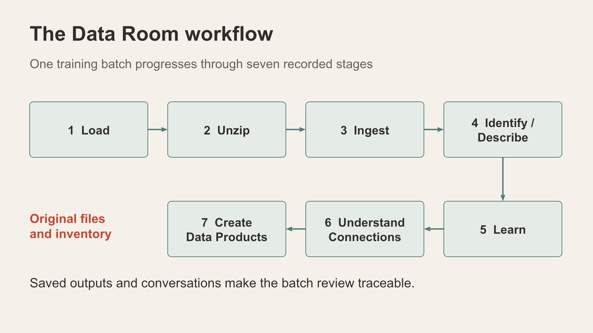

# Part 2 Review content in the Data Room

Move from preloaded incidents to a defined batch of supplied training content. The application navigation currently labels this experience Data Room.

[Download Sample ZIP File](downloads/Sep2026-Cases-V3-Sample-Data.zip), and then unzip.

This will contain Sample Case ZIP files, and Photos for Vector Searching.

*The Data Room workflow records seven stages for a training batch.*

## Begin with a saved batch

Prerequisites: an instructor-selected synthetic batch ID visible to your persona and a known preparation state. Before a live upload exercise, the instructor must document the fixture's files, counts, model configuration and expected pipeline outputs.

1. Open Data Room.
2. In Batch Load History, select the prepared batch using Open, or inspect the already selected batch. Confirm its exact ID and uploader.
3. Inspect Content Stats and Content Headlines after loading completes.
4. Read the saved Batch Brief and identify which descriptions it summarises.
5. Review available source links and saved Connections content. Distinguish authored scene/cast links from similarity comparisons and AI interpretations.
6. Inspect an existing Saved review pack if the batch has completed Stage 7. A missing product means the batch is not prepared for that checkpoint.

Expected result: a learner can trace an inventory item or saved statement back to its source and explain the batch's current stage. Counts depend on the selected fixture and are not universal.

Reset: return to batch history. Keep the prepared batch intact. Remove and the REMOVE BATCH chat command are cleanup actions, not navigation controls.

*Original material, authored context and AI drafts remain distinguishable.*

## Understand the seven stages

| Stage | Purpose | What to inspect |
| --- | --- | --- |
| Load | Retain the supplied ZIP and assign a batch | Batch ID, original archive and checksum |
| Unzip | Extract the accepted files | Inventory and extraction outcome |
| Ingest | Store validated content | Item types, counts and stored sources |
| Identify/Describe | Produce content descriptions | AI drafts and source references |
| Learn what is there | Summarise saved descriptions | Batch Brief, coverage and open questions |
| Understand Connections | Review relationships and comparisons | Link type, supporting source and agent draft |
| Create Data Products | Save a review pack | Product version, manifest and saved review |

Load, Unzip and Ingest run through the upload process. Later stages have explicit controls and prerequisites. A failed or incomplete stage is a state to explain before progressing.

## Prepare a fresh batch exercise

The current ZIP Loader lists a 20 MiB archive limit, 100 files, 8 MiB per file and 40 MiB expanded. It accepts the listed TXT, CSV, JSON, JPG/JPEG, PNG, MP3, M4A and MP4 formats; nested or encrypted archives are excluded. Recheck these limits against the application before preparing a fixture.

An instructor-approved upload uses the synthetic-data checkbox and Load ZIP. Identify/Describe, learning, connections, chat and optional detective tools can invoke configured external AI services. Prepare service access and workshop usage allowances before enabling these activities.

Money flows, messages, people/photos and the Virtual Detective Room are optional extensions. Choose them according to the fixture; they are not requirements for the core batch review.

## Completion checkpoint

Explain one original source, one saved AI draft and one recorded connection without treating them as equivalent. State which pipeline stages are complete and which actions produced the saved outputs.

Troubleshooting: verify batch ownership and selected ID; wait for inventory requests before interpreting initial zeros; check the preceding stage when a Run button is disabled. Retry guidance and cleanup must be confirmed against the selected fixture before this becomes a fully validated upload lab.

MP3/M4A/MP4 originals are retained with checksums and downloads. Stage 4 Identify/Describe transcribes MP3/M4A audio, saves an unreviewed machine transcript and describes it for later analysis. MP4 video analysis remains unavailable; supply JPG/PNG stills or TXT transcripts for video analysis. Existing upload and expansion limits apply.
