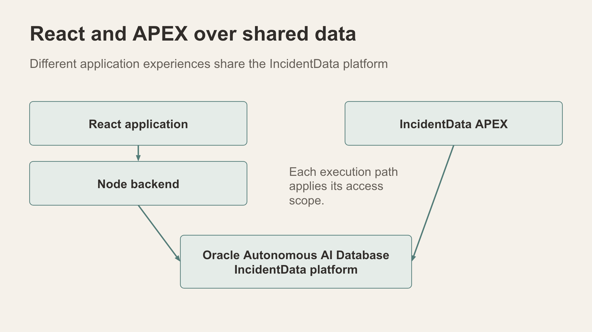
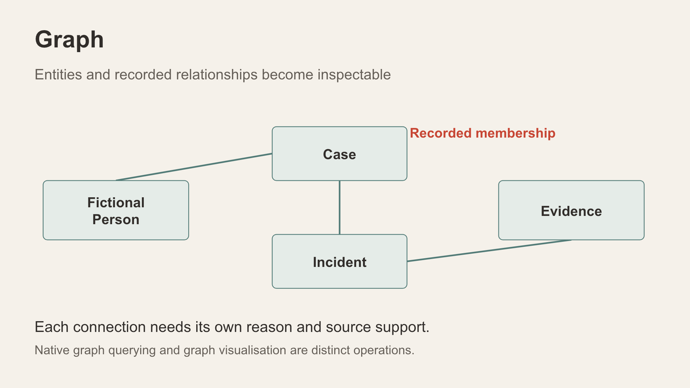

# Part 3 Explore the IncidentData APEX application

Compare an Oracle APEX experience with the React application over the shared data environment. The workshop uses the selected application, App 361.

*Conceptual shared platform: React and APEX use the shared IncidentData environment.*

## Preparation and current status

This chapter is a preparation guide. Its live APEX walkthrough has not yet been validated for this documentation edition. The selected source describes activity, map, pattern, case, people and Data Room pages. Use the current deployment and authentication settings when preparing the final learner steps.

The instructor must confirm the live URL, workspace, parsing schema, current export and permitted learner accounts. Use the application's sign-in flow; React demo personas and authenticated APEX users are different identity mechanisms.

## Planned learner exercise

1. Sign in using the instructor-provided URL and account.
2. Identify the active data scope in an activity view.
3. Inspect a prepared incident or case, then explore its map and relationship context.
4. Compare the fields and underlying record reference with the React experience.
5. Explain which workflow is easier to follow in each interface and what data is shared.
6. Sign out when finished.

Expected outcome: learners can compare two interfaces over shared records while explaining their actual access paths. Exact page labels, fixture references, counts and screenshots will be added after the live walkthrough.

*A conceptual case network makes recorded links inspectable.*

## Points to explain

An APEX graph component can render a relational projection; the visual component alone does not establish native property graph execution. Semantic exercises also need prepared vectors. Avoid promising coverage based on the appearance of a capability badge.

Reset: sign out and leave shared training data unchanged. Installation, export/import and dataset restoration remain instructor tasks.
