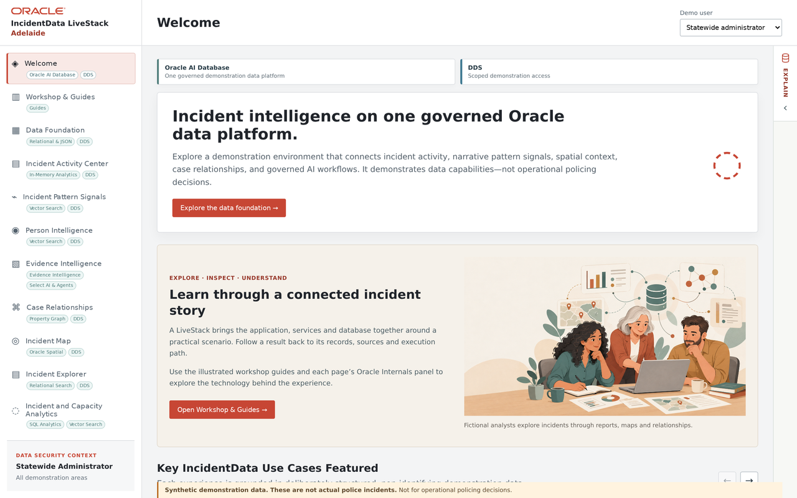

# IncidentData LiveStack — Adelaide workshop

## Introduction

This workshop follows a synthetic payment-document comparison in the Adelaide, South Australia training profile. Start with the authorised data scope, examine a watch and its source records, compare search and graph views, and finish with the two Ask and agent routes plus the Data Room pipeline.

Estimated Time: 115 minutes

### Objectives

- Explain what the selected city and demo persona allow you to see.
- Distinguish original incidents, contextual signals, vector comparisons, recorded links and AI drafts.
- Compare the guided handler routes with the configured Select AI and agent framework routes.
- Trace a synthetic ZIP through the seven Data Room stages.

## Before you begin

1. Open the [IncidentData LiveStack application](http://localhost:18706/) on the demonstration machine. Confirm **IncidentData LiveStack** in the header.

    

2. Use the Adelaide training profile and **Statewide administrator** demo persona for the main path. Your instructor should prepare the profile before learners begin. A restore changes shared application data; it is not a routine learner step.
3. Keep a second browser tab for this guide. Application counts, available cases, vectors, evidence and saved batches depend on the active profile, persona and preparation state. Read what your session actually shows.
4. Use only synthetic training material. The demo-persona selector illustrates scope; it is not production authentication. Do not use this application for operational policing decisions.

## Route through the workshop

Start in **Workshop & Guides** to obtain the training package, then continue through **Data Foundation** and Scenes 2–12. The route ends at **Scene 14: AI Opps**; the earlier Data-Room2 preview chapter is intentionally left out of this cut. Short Redwood inspired animations are placed beside the duality, vector, security, watch graph, Ask, agent and Data Room explanations.

## Credits and scope

This recut follows the requested Adelaide experience and the local IncidentData application/workshop source available on 23 October 2026. Conceptual illustrations are original project assets. They explain ideas; they are not screenshots of a live Adelaide restore or proof that every optional AI service is ready.
