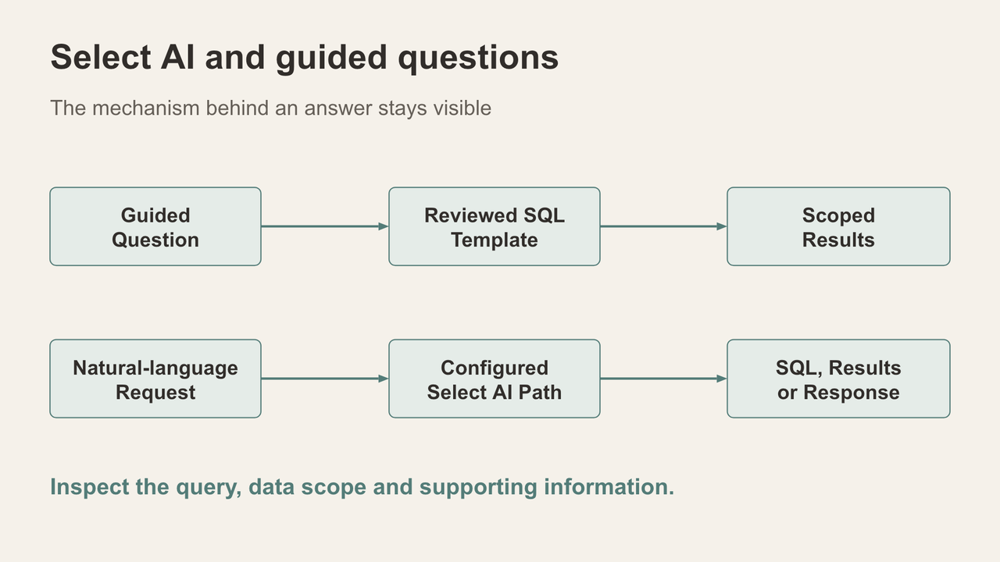
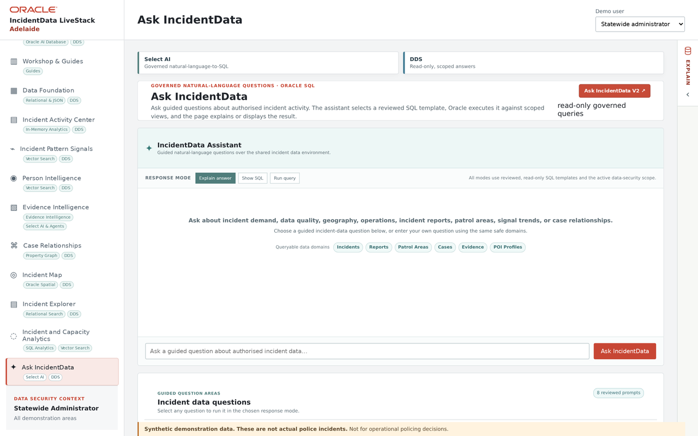

# Scene 10: Ask IncidentData

## Introduction

The page presents two ways to ask about authorised data. Keep the SQL-handler guided route separate from the configured Select AI route that may invoke an LLM.

Estimated Time: 10 minutes

### Objectives

- Inspect one reviewed, read-only guided SQL question.
- Observe a configured Select AI question if that service is ready.
- Relate native AI activity to the later **AI Opps** dashboard.

## Task 1: Bottom Ask route — SQL handler

**Animated pause:** [Two ways to ask](../powtoons/index.html?story=ask).

1. In the lower **Ask** area, choose a displayed guided question. Select **Show SQL** before running it where that response mode is available.

    

2. Read the reviewed SQL template, active scope, date conditions and returned row count. Use **Run query** or **Explain answer** to compare output modes.
3. Explain why a handler-wired, read-only query can be efficient and predictable. It maps the question to approved SQL; it is not evidence that an LLM generated the query.

## Task 2: Top Ask route — Select AI

1. In the upper Ask area, use the prepared Select AI example if the configured service is available. Record the question, actual response and any SQL or source context exposed by the page.
2. Explain that this route can use a configured LLM. Compare its answer with the guided route without assuming the same execution path or identical wording.
3. Later in **AI Opps**, look for the corresponding native AI activity. If configuration, permissions or provider access are missing, show the visible state and do not claim that an LLM call completed.

## Continue

Compare guided and native agent execution in **AI Agent Console**.
