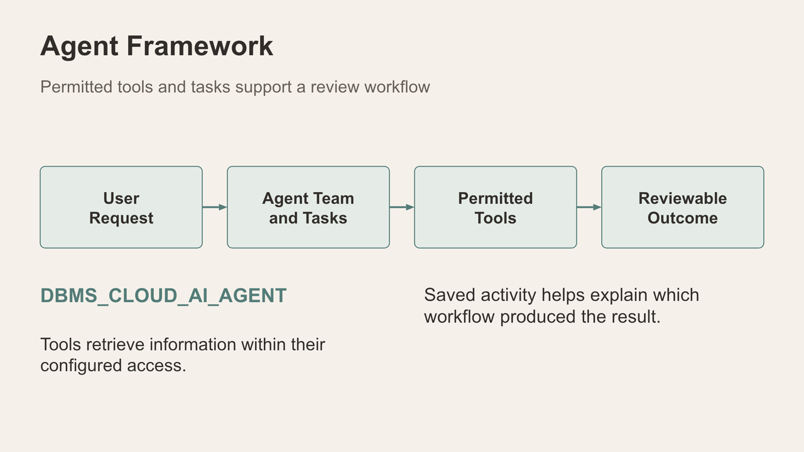
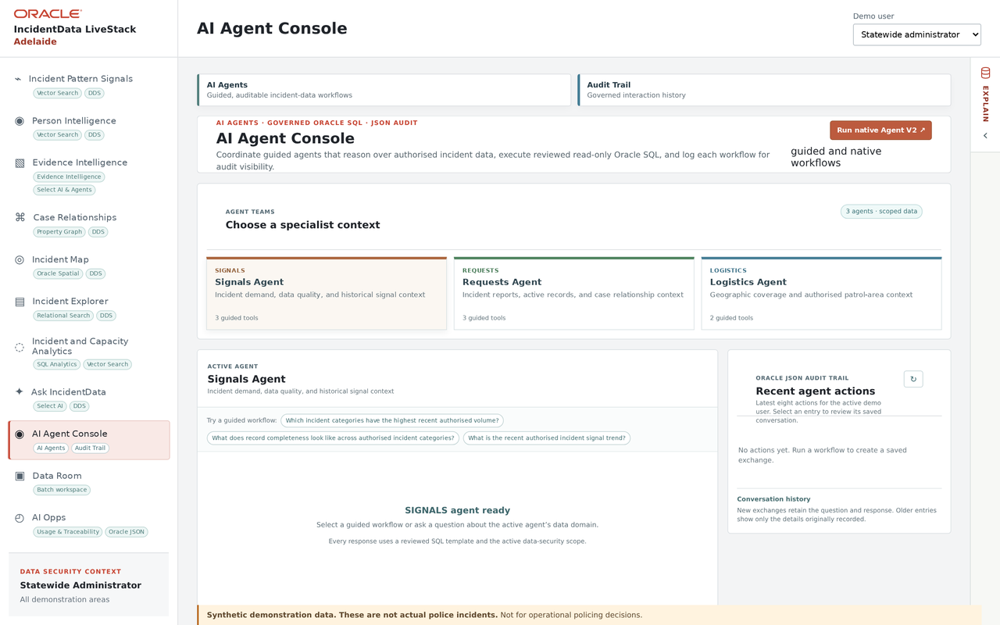

# Scene 11: AI Agent Console

## Introduction

Compare a lower, handler-wired **Run agent** route with the upper route built around the configured AI Agent Framework. Both need reviewable results and clear source scope.

Estimated Time: 10 minutes

### Objectives

- Review the Signals, Requests and Logistics specialist contexts.
- Distinguish a guided PL/SQL/SQL handler workflow from a native agent team using tasks and permitted tools.
- Inspect audit activity and connect native AI calls to **AI Opps**.

## Task 1: Bottom Run agent route — guided handler

**Animated pause:** [Two ways to run an agent](../powtoons/index.html?story=agents).

1. Select **AI Agent Console**. Review the Signals, Requests and Logistics cards and their available guided tools.

    

2. In the lower **Run agent** area, choose a prepared guided workflow. Inspect its reviewed, scoped query/result and any saved action in **Recent agent actions**.
3. Explain the handler-wired route as a controlled way to package database work. The exact PL/SQL handler implementation should be confirmed from the deployed build before presenting code-level detail; a guided answer alone does not prove an LLM call.

## Task 2: Top route — AI Agent Framework

1. In the upper agent area, use a prepared native agent example if the framework and model are configured. Identify the agent or team, tasks, permitted tools, actual output and any cited source context.
2. Explain that this route can call an LLM and orchestrate database tools. Review the recorded action rather than inferring completion from a card or button.
3. Find its native activity later in **AI Opps**. If the service is unavailable, record the visible state and keep the guided route as the completed exercise.

## Continue

Move to the separate synthetic-document pipeline in **Data Room**.
