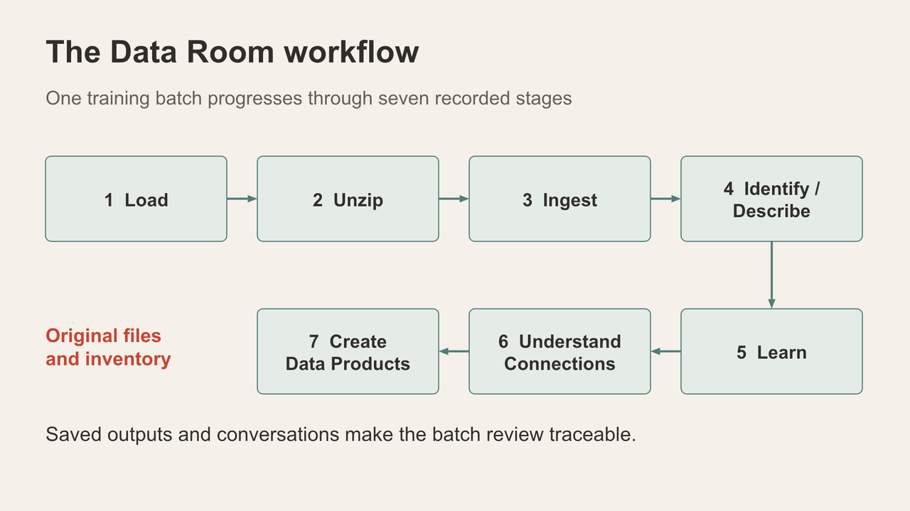
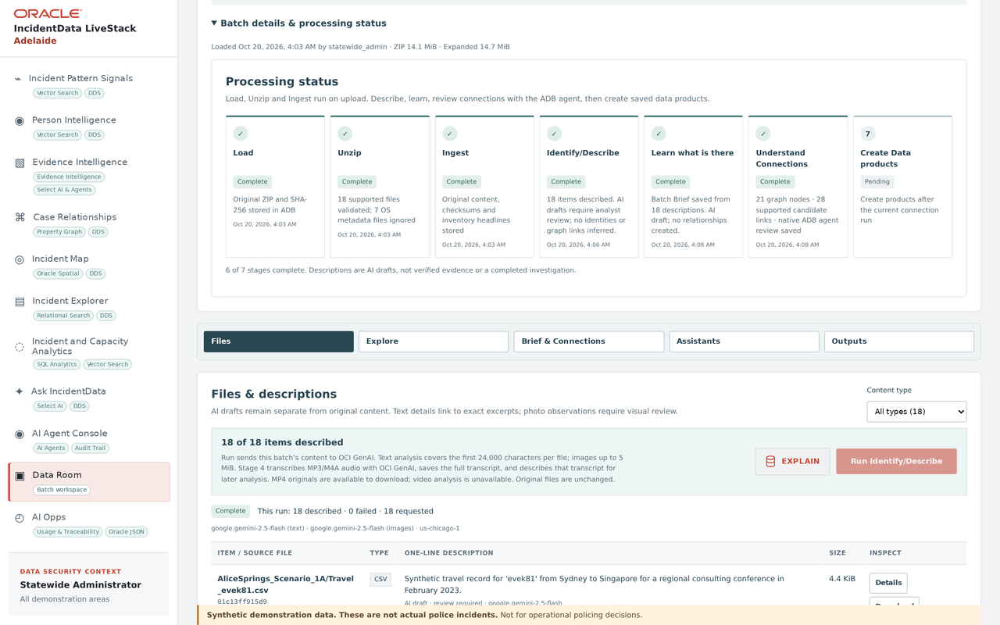

# Scene 12: Data Room

## Introduction

Use a prepared saved batch, or one case ZIP from the **Workshop & Guides** sample package, to explain how synthetic files become traceable descriptions, connections and data products. The saved Alice Springs batch is separate from the Adelaide incident watch.

Estimated Time: 14 minutes

### Objectives

- Explain all seven pipeline stages and the state of one selected batch.
- Use the five workspace tabs to navigate its outputs.
- Keep original files, AI drafts, connection suggestions and saved products distinct.

## Task 1: Choose a prepared batch

1. Select **Data Room**. Under **Choose your batch**, keep **Open existing batch** selected. **Batch Load History** lists the latest batches visible to the current demo user.
2. Find `AliceSprings_Scenario_1A.zip` and select **Open**. Another batch may be marked **Selected** from earlier work; make sure the Alice Springs batch is the one open before continuing. Its history row reads *18 items · Synthetic travel CSVs, inventory-related messages, financial rows, and unverified scene photos*.
3. Expand **Batch details & processing status**. It shows when and by whom the batch was loaded, the ZIP and expanded sizes, and the status of each of the seven stages. Record the batch ID and stage status shown in this session. At the time of writing, the Alice Springs batch had stages 1–6 complete and stage 7 pending.

    

4. If demonstrating a new upload instead, select **Upload new ZIP** to open the **ZIP Loader**:
    - Check the limits it lists: 20 MiB ZIP, 100 files, 8 MiB per file, 40 MiB expanded; TXT, CSV, JSON, JPG/JPEG, PNG, MP3, M4A and MP4; no encrypted or nested archives.
    - Choose one individual case ZIP from the sample package, never the outer package or real evidence.
    - Tick **I confirm this ZIP contains synthetic training data only**, then select **Load ZIP**.
    - For a quick test, **Download sample ZIP** gives a small eight-file batch.
5. After loading, expand **Batch details & processing status**. Load, Unzip and Ingest should show **Complete**. Unzip reports how many supported files were validated and how many operating-system metadata files were ignored. Until stage 4 runs, the **Files** tab marks each one-line description *Inventory-derived · not AI-generated*. A zero shown while requests are still running is not a final inventory.

## Task 2: Explain the seven stages

**Animated pause:** [From ZIP to review pack](../powtoons/index.html?story=data-room).

The stage names below match **Batch details & processing status**.

1. **Load:** retain the original ZIP, assign a batch ID and store its SHA-256 checksum.
2. **Unzip:** extract and validate the supported files from that individual ZIP.
3. **Ingest:** store original content, checksums and inventory headlines.
4. **Identify/Describe:** run from the **Files** tab with **Run Identify/Describe**. It sends the batch's content to OCI GenAI and creates AI descriptions that remain drafts linked to the original files.
    - Text analysis covers the first 24,000 characters of each file.
    - Images are analysed up to 5 MiB.
    - MP3/M4A audio is transcribed and the transcript is described.
    - MP4 originals can be downloaded, but video analysis is unavailable.
5. **Learn what is there:** run from **Brief & Connections** with **Run batch learning**. Saved descriptions are summarised into a source-linked Batch Brief.
6. **Understand Connections:** run from **Brief & Connections** with **Run connections**. Source links, declared synthetic cast/scene context, whole-photo similarity and the ADB agent's review are kept separate. For Alice Springs, the stage reports *21 graph nodes · 28 supported candidate links · native ADB agent review saved*.
7. **Create Data products:** run from **Brief & Connections** with **Create / reopen data products**. It saves a versioned review pack with a manifest and the available outputs.

Load, Unzip and Ingest run on upload. Each later stage has its own control and waits for the stage before it, and may invoke configured AI services. Explain incomplete or failed stages before moving on.

## Task 3: Use the workspace tabs

1. **Files:** under **Files & descriptions**, filter by **Content type**, then use **Details** on one item to open its source reference. **Download** retrieves the unchanged original.
2. **Explore:** under **Choose what to explore**, five tiles show what the batch supports: **Money Flows**, **Messages**, **Travel**, **People mentioned** and **People & Photos**. Each is marked, for example, *Ready to analyse* or *Not recognised*, depending on the batch's content. Inspect themes and candidate connections without treating a suggestion as a fact.
3. **Brief & Connections:** read the **Batch Brief**, its citations, the **Connections & Person / Photo Graph** and the **Saved review pack**.
4. **Assistants:** two specialisations, the **Batch Assistant** and the **Crime Expert Assistant**, answer questions about the saved content. Start with a suggested prompt such as *What does this batch contain?* and check each response against the saved files and brief.
5. **Outputs:** use **Open saved review packs** to open a completed, versioned data product when one exists; state when none exists. **Virtual Detective Room & Video Briefing** can generate an AI-drafted room and briefing for the batch. Treat it as an AI draft that needs analyst review.

## Continue

Finish by inspecting the AI activity and measurement trail in **AI Opps**. **View AI activity ↗** at the top of the Data Room links there.
