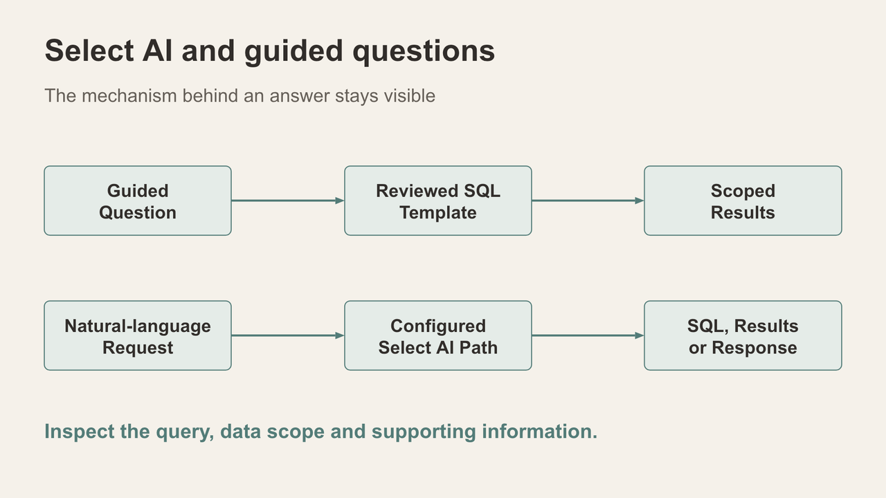
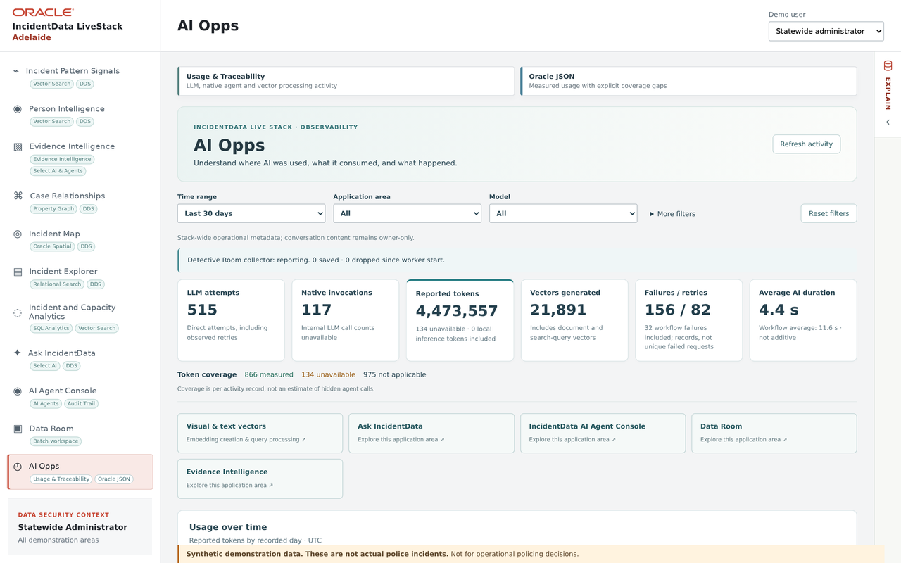

# Scene 14: AI Opps

## Introduction

Close the demonstration by showing what AI activity was recorded and what usage measures are available. Scene 13 from the earlier cut is omitted, so this chapter keeps the requested Scene 14 label.

Estimated Time: 6 minutes

### Objectives

- Find activity from the prepared Select AI and agent-framework examples.
- Explain measured, unavailable and non-AI work without inventing token counts.

## Task 1: Read the activity view

1. Select **AI Opps**. Review activity filters, application areas, usage summary and token-coverage explanation.

    

2. Filter for any native Select AI question from Scene 10 and native agent action from Scene 11 that actually completed. Note the action, time, provider and reported tokens when those fields are present.
3. Contrast those entries with the guided SQL and handler routes. A reviewed query can be useful without invoking an LLM; an empty AI activity list does not mean the guided exercise failed.
4. Explain why native invocation tokens may be unavailable even when another usage measure is shown. Do not infer a missing count.

## Finish

Summarise one original source record, one computed comparison, one recorded link and one AI draft or action. State the active Adelaide scope and any optional exercise that was unavailable in this session.
