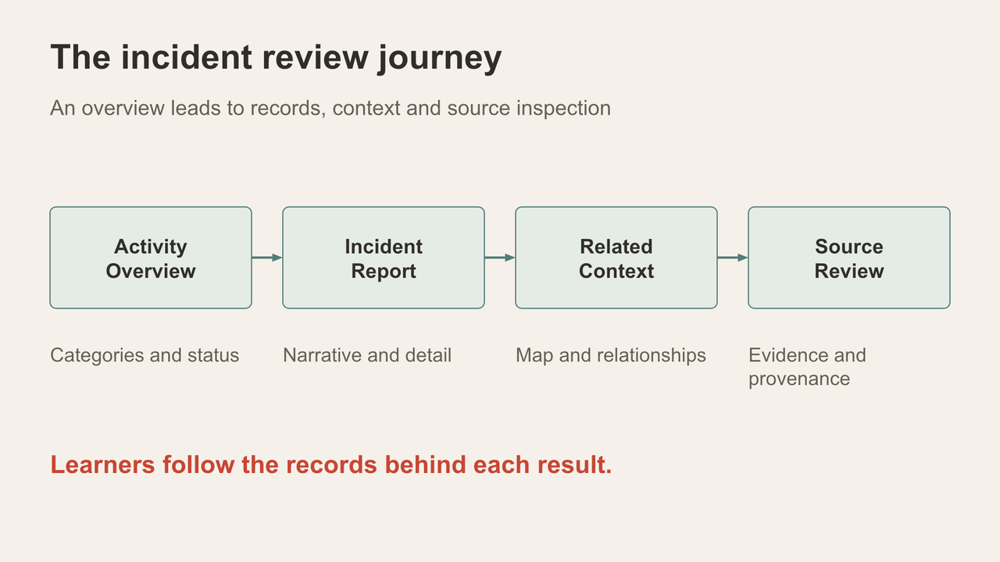
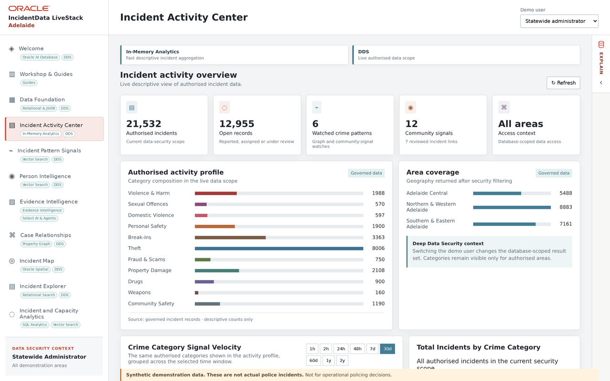

# Scene 2: Incident Activity Center

## Introduction

Begin with descriptive Adelaide activity before following one lead. Counts change with the selected profile, persona, record dates and filters.

Estimated Time: 6 minutes

### Objectives

- Read the current authorised incident and open-record totals.
- Separate watched patterns, community signals and area coverage.

## Task 1: Read the cards

1. Select **Incident Activity Center** with **Statewide administrator** selected. Record **Authorised incidents**, **Open records**, **Watched crime patterns**, **Community signals** and **Area coverage**.

    

2. Compare Central, North and South where the prepared Adelaide profile shows them. If a short relative-time chart is empty, inspect its date window against the stored record dates before drawing a conclusion.
3. If the presenter is demonstrating scope, change to a regional demo user, wait for figures to refresh and record the difference. Return to Statewide administrator before continuing.

## Task 2: Explain the measures

Distinguish a stored incident from a watched pattern and a contextual community signal. A smaller regional total demonstrates different application results; it does not by itself prove native database DDS enforcement.

## Continue

Use **Incident Pattern Signals** to move from the overall view to the payment-document watch.
