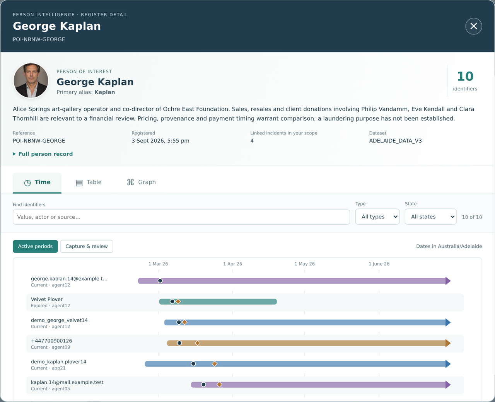
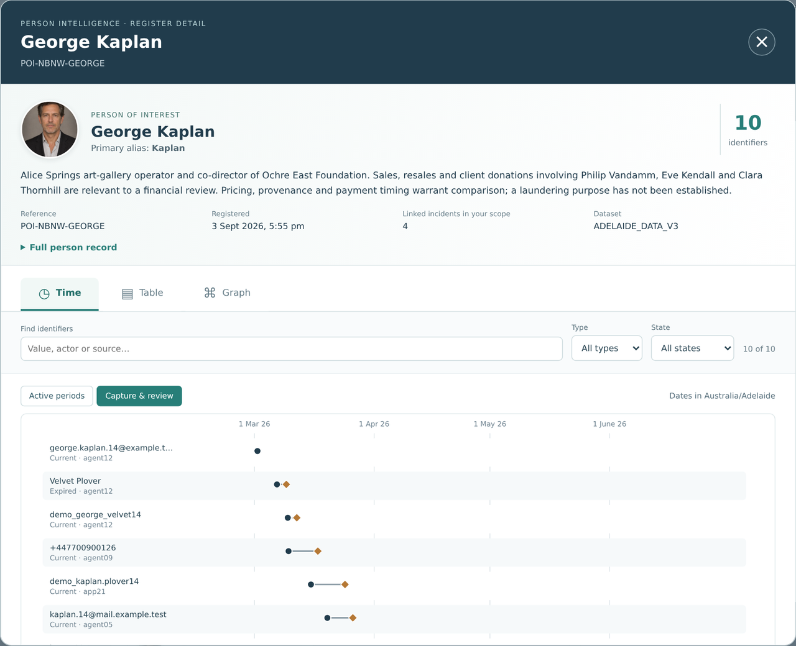
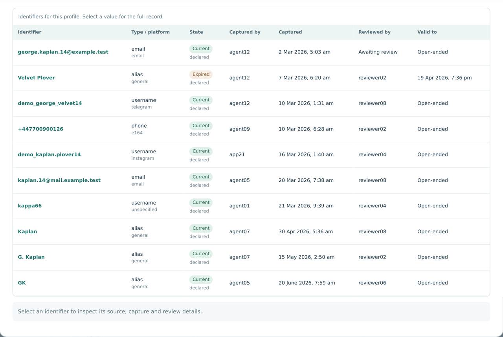
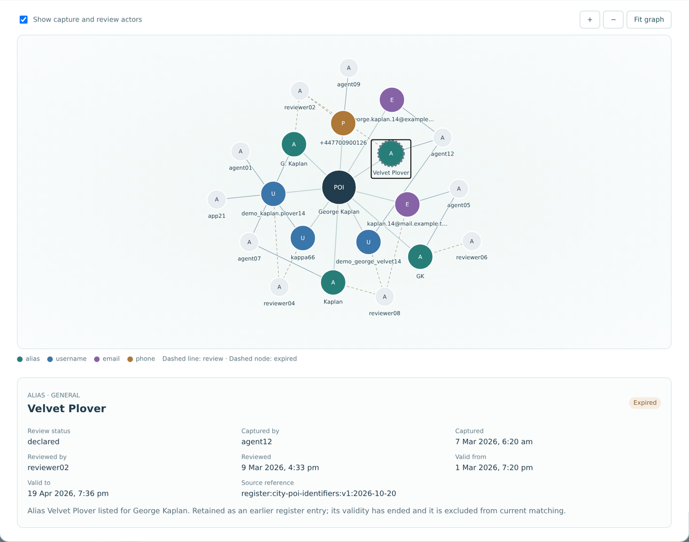

# Scene 4: Person Intelligence

## Introduction

Person Intelligence brings fictional profiles, their identifier register and photo context into review. The register records who captured each alias, username, email or phone number, who reviewed it, and when it was valid. Vector similarity helps find candidates; it does not identify a person or decide responsibility.

This scene uses **George Kaplan** (`POI-NBNW-GEORGE`) because, in the Adelaide V3 profile, he has four linked incidents in scope and a register that shows every state you need: current, expired and awaiting review.

Estimated Time: 12 minutes

### Objectives

- Open a fictional profile and its register detail.
- Read the identifier register three ways: Time, Table and Graph.
- Distinguish validity, administrative review and identity confirmation.
- Compare narrative and photo-vector search as distinct inputs.

### Prerequisites

- The active dataset is **ADELAIDE_DATA_V3**. The register detail shows the dataset name; dates should read **Dates in Australia/Adelaide**.
- The current persona can see `POI-NBNW-GEORGE`. Linked-incident counts depend on the persona's scope.

## Task 1: Select a profile

1. Select **Person Intelligence**. The **Authorised POI profiles** list shows each profile's reference, alias and readiness.
2. Select **POI-NBNW-GEORGE · George Kaplan**. **Selected Profile** shows his alias (Kaplan), summary, status (*person of interest*) and the two stored vectors: *384d narrative vector* and *512d visual vector*.
3. Note that the summary is authored profile text. It describes a line of enquiry, not a finding: "a laundering purpose has not been established".

## Task 2: Open the register detail

1. Select George Kaplan's round portrait in **Selected Profile**. The small ↗ badge shows that it opens the record. You can also focus it with the keyboard and press **Enter**.
2. The **Person Intelligence · Register Detail** window opens. Confirm:
    - **10 identifiers**
    - **Linked incidents in your scope: 4**
    - **Dataset: ADELAIDE_DATA_V3**
3. Expand **Full person record**. It contains the full narrative, the profile attributes and **Recorded incident links**, for example `ACI-2026-16323 · Fraud, deception and related offences`. Each link states its own limits, such as "attribution remains unconfirmed". Collapse it again.

## Task 3: Read the register in time

The register opens on **Time**.

1. In **Active periods**, each bar is one identifier's validity period. An arrow at the right edge means the period is open-ended; the chart does not invent an end date.
2. Find **Velvet Plover**. Its bar stops in April: this alias is **Expired**. Every other identifier is current.
3. Select **Capture & review**. The bars are replaced by events: a dot (●) where an identifier was captured and a diamond (◆) where it was administratively reviewed. `george.kaplan.14@example.test` has a capture dot but no diamond, because it is still awaiting review.

> **Teaching point:** *Current* and *Expired* are validity states. Administrative review is a separate step, and it does not confirm identity or account ownership.

## Task 4: Read the register as a table

1. Select **Table**. Each row shows the identifier, its type and platform, state, who captured it and when, who reviewed it, and when it stops being valid.
2. Check these rows:

    | Identifier | Type / platform | State | Reviewed by | Valid to |
    |---|---|---|---|---|
    | george.kaplan.14@example.test | email | Current | Awaiting review | Open-ended |
    | Velvet Plover | alias | Expired | reviewer02 | 19 Apr 2026 |
    | demo_george_velvet14 | username / telegram | Current | reviewer08 | Open-ended |
    | kappa66 | username / unspecified | Current | reviewer04 | Open-ended |

3. Use the filters above the table. They apply to Time, Table and Graph alike:
    - Set **State** to **Expired**. Only Velvet Plover remains.
    - Set **State** back to **All states**, then set **Type** to **alias**. Velvet Plover, Kaplan, G. Kaplan and GK remain.
    - Type `reviewer08` in **Find identifiers** to see every entry that reviewer touched. Clear the filters before continuing.

## Task 5: Read the register as a graph

1. Select **Graph**. George Kaplan sits at the centre (**POI**). Each identifier is a node coloured by type: alias, username, email or phone. The grey nodes are the people and apps that captured or reviewed each entry, for example `agent12` and `reviewer02`.
2. Read the legend. A dashed line is a review; a dashed node outline is an expired identifier. Find Velvet Plover's dashed outline.
3. Select **Velvet Plover**. Its detail panel shows:
    - captured by agent12 on 7 Mar 2026
    - reviewed by reviewer02 on 9 Mar 2026
    - valid from 1 Mar to 19 Apr 2026
    - source reference `register:city-poi-identifiers:v1:2026-10-20`
    - the note that its validity has ended and it is excluded from current matching
4. Clear **Show capture and review actors**. The graph reduces to George and his 10 identifiers. Use **+**, **−** and **Fit graph** to zoom, then turn the actors back on.

> **Note:** In the graph, both aliases and actors carry the letter **A**. Colour tells them apart: teal for aliases, grey for actors.
>
> This network is drawn in the browser from the secured register query. It is not an Oracle SQL property graph; Scene 6 covers that.

5. Press **Escape** or select **×** to close. Focus returns to the portrait.

## Task 6 (optional): A busier register

1. Select **POI-NBNW-PHILIP · Philip Vandamm**, George's gallery client, and open his register detail. It has 13 identifiers.
2. In **Table**, set **State** to **Proposed**. Three aliases remain: `vanders`, `pippster` and `pippy`. They were captured but not yet accepted into the register. Set **State** back to **All states**.
3. Compare his **Graph** with George's. More identifiers and reviewers make it denser, which is when the filters and **Show capture and review actors** become useful.

## Task 7: Explore vector comparisons

**Animated pause:** [Similarity is a lead](../powtoons/index.html?story=vector). The final beat connects the teaching example to narrative and supplied-photo comparisons.

1. Reselect George Kaplan. Under **Narrative vector search**, the box may already hold a suggested description. Replace it with *art gallery sales and client donations* and select **Search narratives**.
2. Results are ranked by narrative similarity: George Kaplan first (about 0.57), then Eve Kendall, Philip Vandamm and Clara Thornhill. Exact scores can vary with the embedding model. Related wording ranks nearby profiles, so read each summary before discussing a candidate. A high score means similar wording, not involvement.
3. Under **Visual vector search**, choose a test image using only the supplied synthetic photos from the sample package or an existing prepared batch. Record the model, threshold and source shown by the interface. A whole-photo similarity result may reflect scene composition; it is not facial identity proof.
4. Both searches generate model vectors outside the application UI. Oracle then ranks authorised rows with `VECTOR_DISTANCE(..., COSINE)` through `secure_persons_of_interest_v`. If a profile lacks compatible embeddings or a photo set, explain the prerequisite and use the conceptual vector tile from Scene 1. Do not invent a match.

## Continue

Check whether the active scope has an Evidence Intelligence pack. George Kaplan's art-market incidents are a natural thread to follow.
