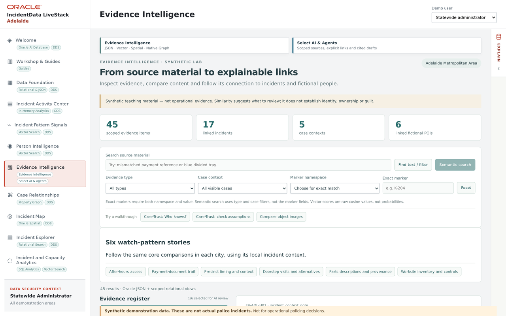

# Scene 5: Evidence Intelligence

## Introduction

Check available source material before making an evidence claim. Visibility can differ across Adelaide profile restores and demo personas.

Estimated Time: 5 minutes

### Objectives

- Establish whether scoped evidence items and case context are visible.
- Trace any displayed item to its original source.

## Task 1: Inspect availability

1. Select **Evidence Intelligence**. Wait for the summary cards and filters to load.

    

2. Record the visible evidence-item, incident, case and fictional-person counts. If the screen says no pack is visible, state that limitation and do not demonstrate an imaginary result.
3. If items exist, choose one, inspect its source label and link type, and distinguish original content from AI descriptions or similarity suggestions.

## Continue

Use **Case Relationships** to follow recorded case links, regardless of whether a dedicated evidence pack is present.
