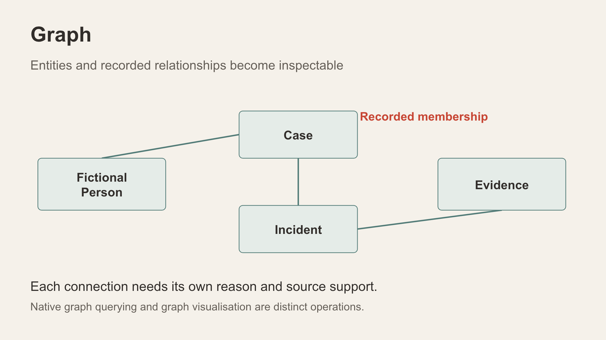
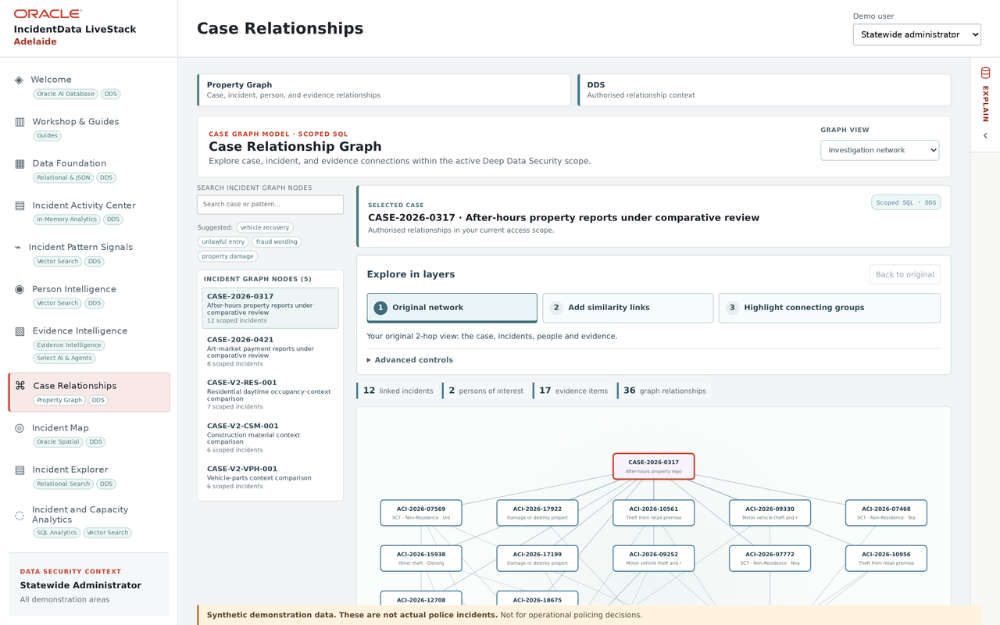

# Scene 6: Case Relationships

## Introduction

Use a payment-document case that exists in the active Adelaide scope. Compare the graph presentations while keeping the same case and underlying sources in view.

Estimated Time: 10 minutes

### Objectives

- Inspect the case's incident, fictional-person and evidence-reference context.
- Compare all four graph-view choices, especially **Oracle Graph Explorer**.

## Task 1: Select a case and source

1. Select **Case Relationships** and choose the case referenced by the payment-document watch. Record its actual reference before presenting the graph.

    

2. Read the case summary and node/link counts. Open a connected incident or detail card and identify the original record behind one link.

## Task 2: Compare graph views

1. Switch through all four view choices displayed in this build, holding the same case constant. The known options include **Pathway Style**, **Force-directed network** and **Oracle Graph Explorer**; read the fourth option's exact label from the live screen rather than inventing it.
2. In each view, point out how layout, clustering or exploration controls change the way relationships are inspected. Explain which links are recorded and which are optional similarity comparisons.
3. Spend extra time in **Oracle Graph Explorer**: select a node, follow one edge and use the available details to return to a source. If the Explorer needs separate configuration or does not load, record that result and continue with the available views.

**Interpretation:** A graph drawing can render scoped relational links, while other features may query a native database graph. The visual style alone does not prove the database execution mechanism or a common offender.

## Continue

Add approximate geographic context in **Incident Map**.
