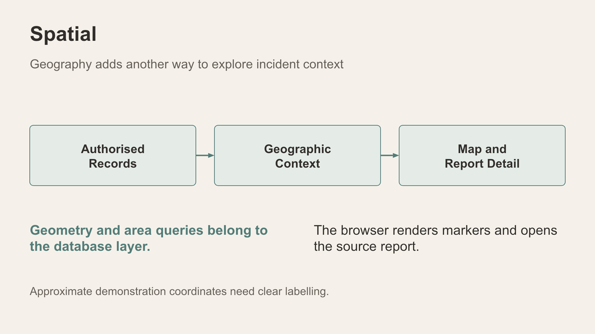
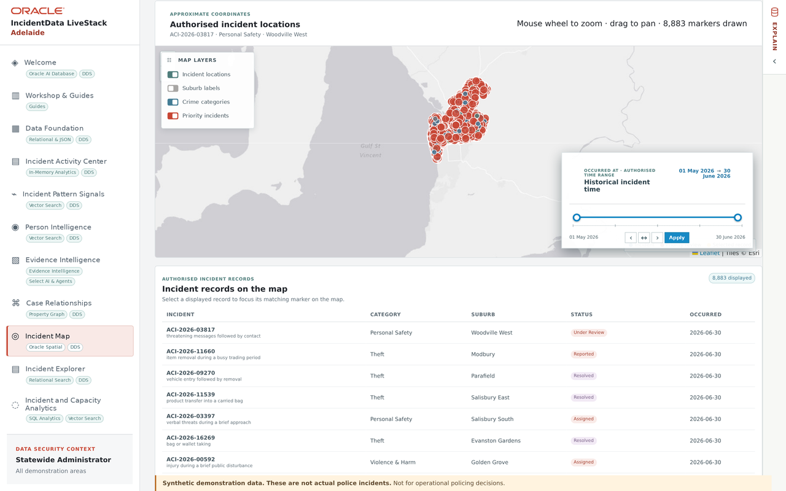

# Scene 7: Incident Map

## Introduction

The map adds approximate location context to authorised records. Its drawn markers can be fewer than all matching incidents.

Estimated Time: 8 minutes

### Objectives

- Use category, area, status and time controls.
- Explain map precision and marker limits.
- See how database security changes what each persona can map.

## Task 1: Inspect the map

1. Select **Incident Map**. Read the summary cards: **Displayed map markers** (for example, *2,500 of 21,532 matching records*), **Active incidents**, **Suburbs represented** and **Priority markers**.
2. The map draws the most recent **2,500** markers by default. Under **Markers to draw**, choose **All matching markers** and select **Update map**. Incidents now fill the metropolitan area across 394 suburbs.

> **Note:** Filter changes apply only when you select **Update map**. Until then, the summary cards still describe the previous view.

## Task 2: Filter by patrol area

1. Under **Patrol area**, choose **Northern & Western Adelaide** and select **Update map**. The markers form one region: the coast from Henley Beach and Seaton north through Port Adelaide, and the northern suburbs from Enfield to Elizabeth and Golden Grove. **Displayed map markers** should read *8,883 of 8,883* when all markers are drawn.

    

2. Repeat with **Adelaide Central** (the CBD and inner suburbs, about 7 km out) and **Southern & Eastern Adelaide** (Glenelg and Marion south to Seaford, plus the eastern suburbs and hills).
3. Change one more filter at a time (category, status or month) and explain the observed change. Return **Patrol area** to **All authorised areas** when you finish.

## Task 3: Compare personas

1. In **Demo user** at the top right, choose **Northern analyst**. Without any filter, the map shows only Northern & Western Adelaide: **Displayed map markers** reads *2,500 of 8,883* because the marker limit returns to its default. The database's scoped view, not the map, removes the other areas.
2. Try **Central analyst** and **Southern analyst**, then return to **Statewide administrator**.
3. If a marker opens a detail, compare its approximate position with the source report's location wording.

**Interpretation:** Each point is an approximate synthetic location inside the named suburb, not an address. Display limits and clustering can reduce drawn markers. Nearby positions do not establish a common event or causal relationship.

## Continue

Use **Incident Explorer** to inspect original report detail with several search methods.
