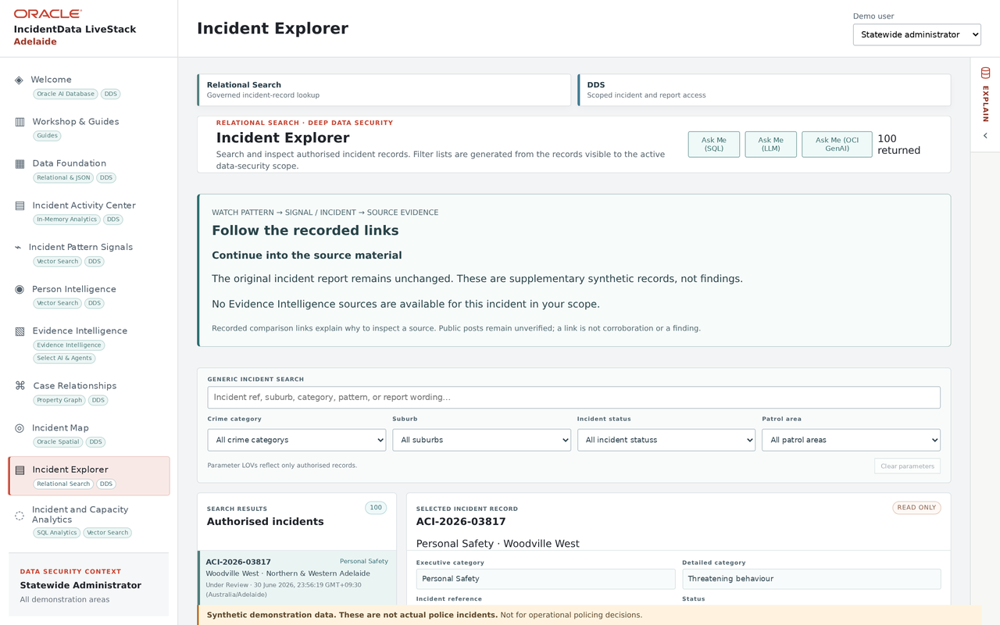

# Scene 8: Incident Explorer

## Introduction

Move from a watch, map marker or graph node to an original incident report. This scene also compares the available search controls.

Estimated Time: 8 minutes

### Objectives

- Find records through free text and structured filters.
- Read report details and distinguish them from computed links.

## Task 1: Compare search methods

1. Select **Incident Explorer** and allow records and filter lists to load.

    

2. Try **GENERIC INCIDENT SEARCH** with a phrase or the incident reference recorded in Scene 3. Move focus away from the field if needed, then wait for the result count to update.
3. Clear that search. Compare category, suburb, patrol area, status and other available filters one at a time. Record which controls narrow the result set in your Adelaide session.

## Task 2: Read one result in detail

1. Open one returned incident. Read its reference, category, status, dates, approximate location, **REPORT SUMMARY** and **REPORT NARRATIVE**.
2. Check the read-only attributes and any person/evidence counts. Distinguish the source report from a watch membership, semantic match or analyst interpretation.
3. Record the incident reference for later discussion. Clear search filters when finished.

## Continue

Return to aggregate patterns in **Incident and Capacity Analytics**.
