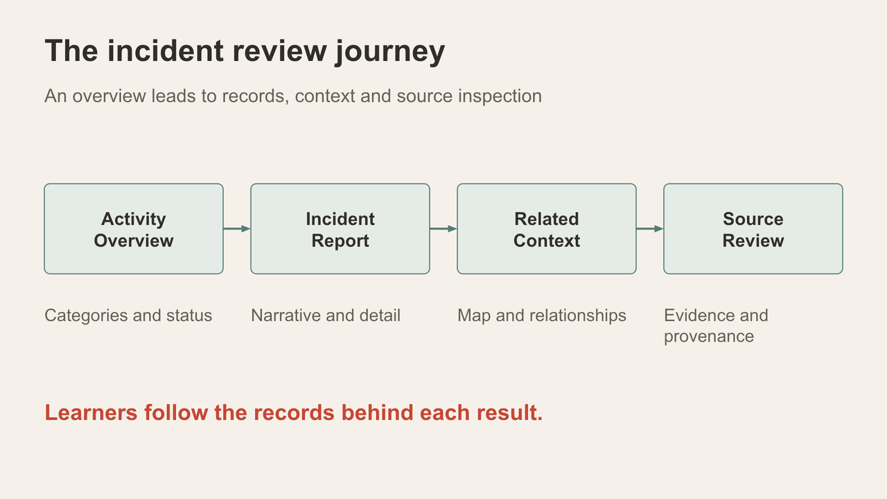
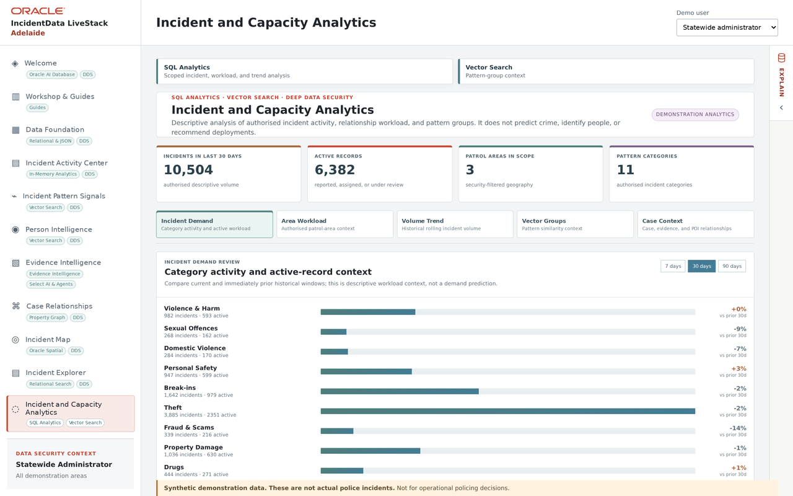

# Scene 9: Incident and Capacity Analytics

## Introduction

Place individual Adelaide reports in descriptive historical context. Relative-time panels depend on the stored incident dates.

Estimated Time: 6 minutes

### Objectives

- Read incident demand, workload and trends within the active scope.
- Explain the difference between descriptive counts and prediction.

## Task 1: Explore the panels

1. Select **Incident and Capacity Analytics**. Start with **Incident Demand**.

    

2. Inspect **Area Workload**, **Volume Trend**, **Vector Groups** and **Case Context** if populated. Record the date window and active persona alongside any figures you present.
3. If a recent-period result is empty, compare the window with the dates in the saved Adelaide profile before interpreting it.

**Interpretation:** Historical volumes and groupings describe returned records; they do not predict incidents or recommend deployment.

## Continue

Compare the two routes for asking questions of authorised data.
