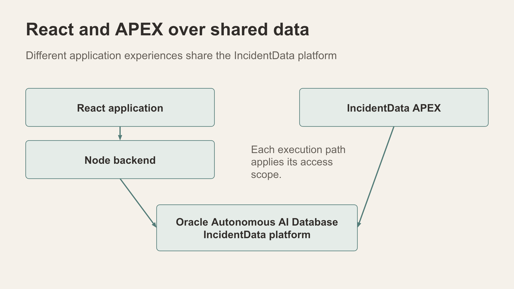
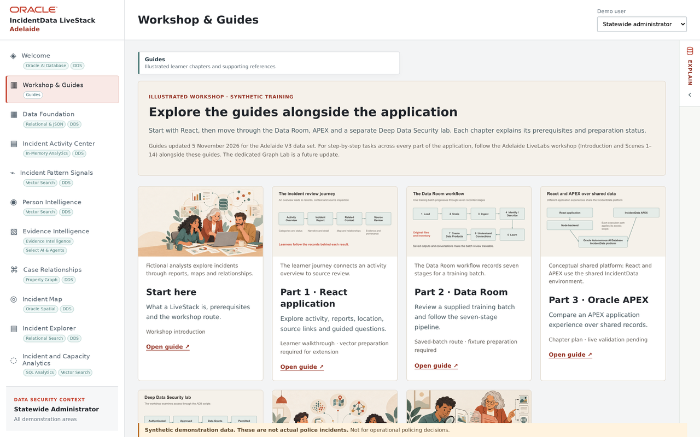

# Workshop & Guides — prepare the sample package

## Introduction

Collect the supplied synthetic training material before opening the scene sequence. The package includes test archives and photos that can support later Data Room and person-comparison exercises.

Estimated Time: 8 minutes

### Objectives

- Find the Part 2 Data Room guide and download its sample package.
- Separate the outer download from the individual ZIP files intended for testing.
- Keep the photos and their provenance available for the vector discussion.

## Task 1: Open Part 2

1. In the app's left navigation, select **Workshop & Guides**. The page lists companion guides: **Start here**, **Part 1 · React application**, **Part 2 · Data Room**, **Part 3 · Oracle APEX** and a **Deep Data Security lab**. These complement this workshop; they do not replace these scenes.

    

2. On the **Part 2 · Data Room** card, select **Open guide ↗**. The guide opens in a new browser tab.
3. Select **Download Sample ZIP File**. This downloads `Sep2026-Cases-V3-Sample-Data.zip` (about 72 MB). Save it to a clearly named local folder and keep the original download intact.

> **Note:** The Data Room's ZIP Loader also has a **Download sample ZIP** button. That one is different: it gives `incidentdata-room-synthetic-sample.zip`, a small eight-file batch for a quick upload test. Use the Part 2 package for this workshop.

## Task 2: Unzip and inspect

1. Expand the downloaded outer package with your laptop's archive utility. On a Mac you may also see `__MACOSX` folders and `.DS_Store` files; ignore them.
2. Inside `Sep2026-Cases-V3-Sample-Data/` you should find:

    | Item | Contents |
    |---|---|
    | Seven case ZIPs | `AliceSprings_Scenario_1A.zip`, `Brussels_Conference_Trail_2a.zip`, `Chris_Drugs.zip`, `Gianni_Money.zip`, `Scene200_Brussels.zip`, `Scene2b_Drug.zip`, `Scene4_Suga.zip` |
    | `POI_Photos/` | Nine fictional profile portraits, for example `george-kaplan.png` and `philip-vandamm.png` |
    | `Face_Search_Photos/` | Ten test photos in pairs (`dp1`/`dp2`, `eg1`/`eg2`, `mv1`/`mv2`, `nk1`/`nk2`, `tr1`/`tr2`) |

3. Keep the individual case ZIPs separate. Each one is a single Data Room batch; do not upload the outer package as though it were one batch.
4. Note which photos are supplied synthetic material. They may be used later to discuss whole-photo vector similarity and person/narrative comparison, where the feature and prepared data are available. A photo similarity result is not an identity finding.
5. Do not upload, delete or rerun a batch yet. Scene 12 explains the pipeline and its prerequisites.

## Continue

Move to **Data Foundation** and confirm the selected city and data scope.
